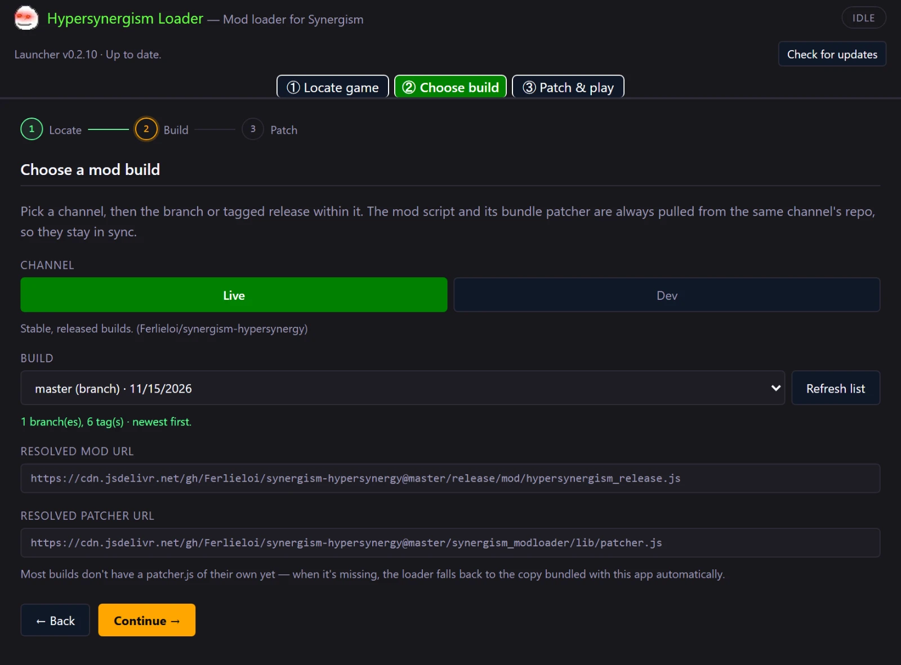
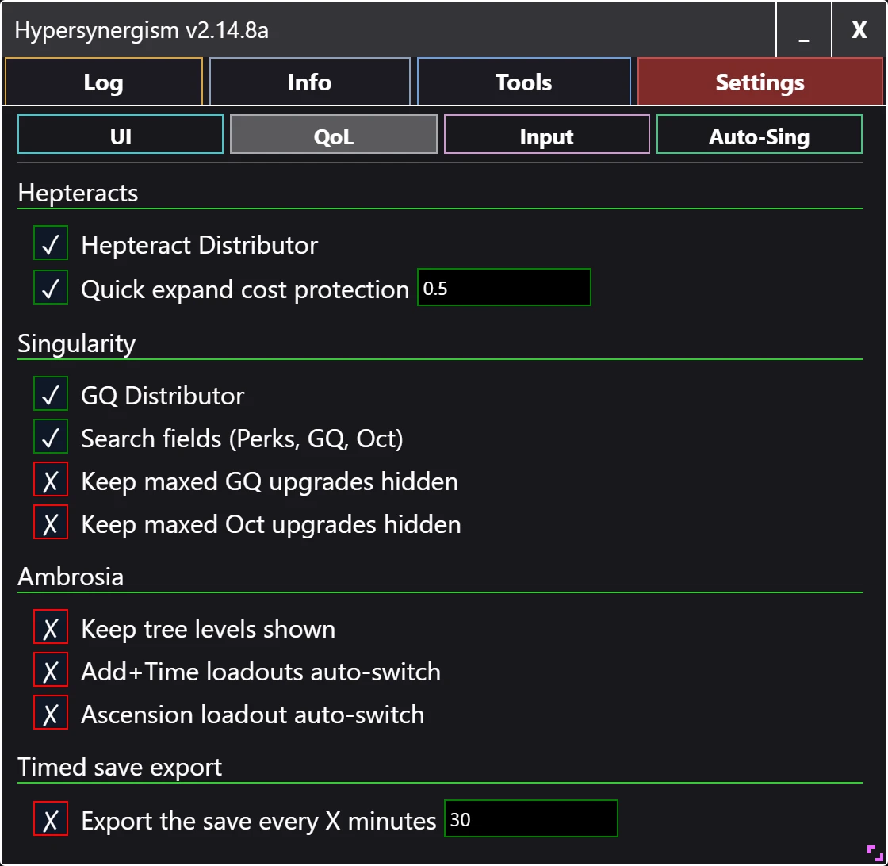
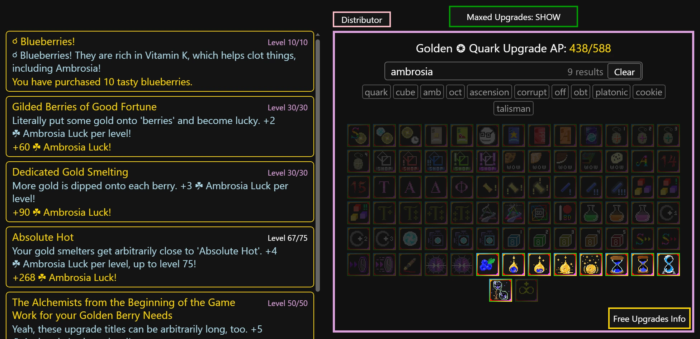
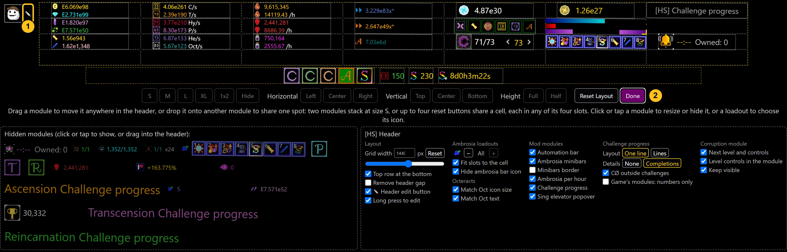
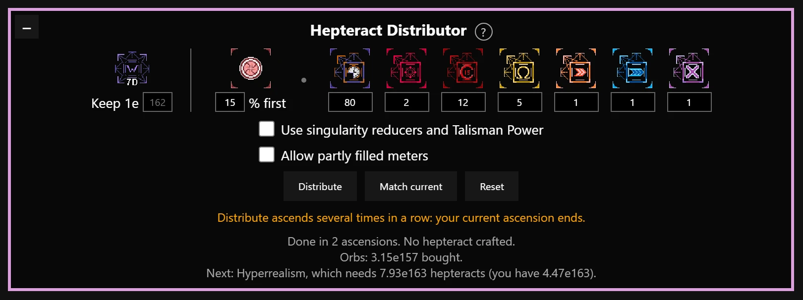
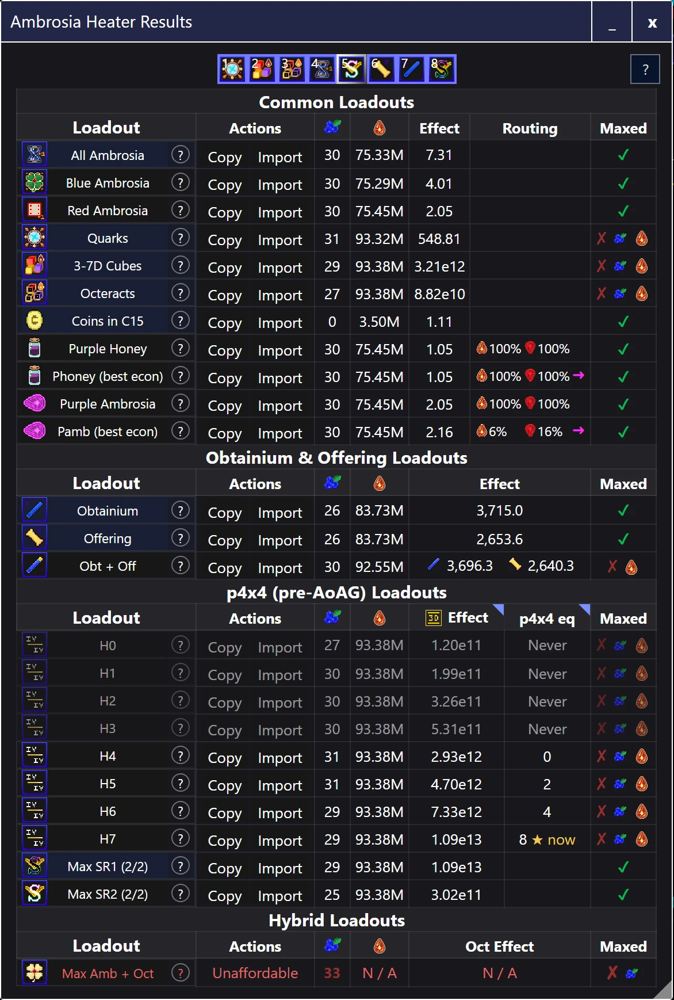

# Hypersynergism feature inventory

Generated from the reviewed feature catalogue. Every feature includes its location, usage, limits and source references.

## Installation & updates

Choose the browser userscript or the Windows Steam loader. Both patch the game before loading the mod. A patch step that can't be applied is reported once at load, with details in the Log tab.

**Sources for this category:** [tampermonkey-bridge.user.js](https://github.com/Ferlieloi/synergism-hypersynergy/blob/master/src/loader/tampermonkey-bridge.user.js) · [loaders.md](https://github.com/Ferlieloi/synergism-hypersynergy/blob/master/docs/features/loaders.md) · [README.md](https://github.com/Ferlieloi/synergism-hypersynergy/blob/master/synergism_modloader/README.md)

Step by step: [Installation guide](https://ferlieloi.github.io/synergism-hypersynergy/docs/wiki/getting-started-guide.html).

### Browser userscript

Loads Hypersynergism automatically with the game.

**Where:** Tampermonkey → install the Live bridge userscript

- Install Tampermonkey, allow user scripts in Chrome-based browsers, then install src/loader/tampermonkey-bridge.user.js from Live.
- Works at synergism.cc and pseudo-corp.github.io/SynergismOfficial/. Reload the game after installing.

**Availability and limits**

- The two game addresses have separate saves. The game's GitHub Pages address has no login, cloud saves or purchases.

### Recover when the browser loader starts late

Retries loading when Tampermonkey starts after the game.

**Where:** Settings → UI → Reload when the loader starts late

- The browser bridge can reload up to three times, then shows a message asking you to refresh.
- Disable automatic retries to see the refresh message immediately.

**Availability and limits**

- Tampermonkey/browser only; this does not retry unrelated network or patch failures.

**Related settings:** [Reload when the loader starts late](https://ferlieloi.github.io/synergism-hypersynergy/docs/wiki/settings.html#reloadOnLateLoaderStart)

### Windows Steam loader

Patches a copy of the Steam game and launches it with the mod.

**Where:** GitHub Releases → Hypersynergism Loader

- Choose the installed game and a mod channel/build. Patch & launch prepares the copy; Launch only and Quick switch reuse it when compatible.
- The loader can update itself and detects when a game, patcher, injector or patch format change requires re-patching.
- The current loader bundles its extraction tool; a separate full 7-Zip installation is not required.

**Availability and limits**

- Windows only. Re-patch when requested; reloading the mod alone does not update an already patched Steam copy.

### Live and Dev channels

Choose between the Live and Dev repositories.

**Where:** Browser loader configuration / Steam loader build selection

- Live is Ferlieloi's repository (Ferlieloi/synergism-hypersynergy). Dev is Shewchou's repository (maenhiir/synergism-hypersynergy).
- In the browser bridge, change the repo owner only when intentionally switching channels. Steam also supports selecting builds; development has a local loader.
- Live is generally more stable.

### Legacy bookmarklet and migration help

Keeps a legacy loading path and shows how to switch to Tampermonkey.

**Where:** Legacy bookmark / Tools migration notice

- The bookmarklet loads after the game starts. A migration window provides installation steps and the bridge script to copy.

**Availability and limits**

- Bookmarklet loading is not recommended: it lacks direct game access, has slower fallbacks, and cannot support every feature reliably.

### Channel-aware update notifications

Marks a newer version with a rainbow icon border and a panel-title notice.

**Where:** Mod icon / panel title / Tools → CHECK VERSION

- Checks at load and every 30 minutes until a newer version is found; CHECK VERSION runs a manual check.
- Live follows stable version tags. Dev follows its own development builds and separately notifies about newer Live releases.
- Reload the game to pick up the latest build from the selected channel.

**Source:** [version-check.md](https://github.com/Ferlieloi/synergism-hypersynergy/blob/master/docs/features/version-check.md)

## Interface & navigation

The mod panel and quick menu, hidden tabs and remembered subtabs, search fields, and choices for the game's dialogs and notifications.

**Sources for this category:** [hs-ui.ts](https://github.com/Ferlieloi/synergism-hypersynergy/blob/master/src/mod/class/hs-core/hs-ui.ts) · [hs-settings-ui.ts](https://github.com/Ferlieloi/synergism-hypersynergy/blob/master/src/mod/class/hs-core/settings/hs-settings-ui.ts) · [dialogs.md](https://github.com/Ferlieloi/synergism-hypersynergy/blob/master/docs/features/dialogs.md) · [subtab-memory.md](https://github.com/Ferlieloi/synergism-hypersynergy/blob/master/docs/features/subtab-memory.md) · [singularity-search.md](https://github.com/Ferlieloi/synergism-hypersynergy/blob/master/docs/features/singularity-search.md)

### Movable, resizable mod panel

Groups settings, tools, logs and information in the game's visual style.

**Where:** Hypersynergism icon → mod panel

- Drag the panel, resize it, or minimize it while keeping the game accessible.
- Settings are grouped into pages; tooltips explain their individual controls.
- The mod's own notifications stack in one column at the top centre: hover one to keep it, click it to dismiss it.
- The Tools tab's Mod links open the mod's website, its GitHub repository and its Discord thread.

### Quick access menu

Opens common tools without navigating the full panel.

**Where:** Mod icon → quick access menu

- Provides quick access to Start Auto-Sing, the integrated Ambrosia Heater and the Heater data export.
- Uses the same underlying actions as the Tools tab.

### Hide tabs and remember hidden tabs

Keeps unwanted main tabs hidden across reloads.

**Where:** Settings → UI → Hide vanilla tabs; game's tab editor

- Select a tab in Hide vanilla tabs to hide it; select it again to restore it.
- Changes made with the game's own tab close/hide controls are synchronized back to the mod's saved preference.
- The PseudoCoins tab is also made hideable. Hidden tabs are retained in the game's ordered tab list so they can be restored.

**Related settings:** [Hide vanilla tabs](https://ferlieloi.github.io/synergism-hypersynergy/docs/wiki/settings.html#hiddenVanillaTabs)

### Remember each tab's last subtab

Returns a tab to the subtab you last used after resets and reloads.

**Where:** Settings → UI → Remember last used subtab

- Remembers each main tab separately and stores the selection when you leave it.
- If a remembered subtab is locked, the choice is kept and retried when it becomes available.
- A subtab deliberately opened by another game action is generally left alone.

**Availability and limits**

- Disabling the feature forgets its remembered selections. Some reset and shortcut cases still follow the game's default behavior.

**Related settings:** [Remember last used subtab](https://ferlieloi.github.io/synergism-hypersynergy/docs/wiki/settings.html#rememberSubtabs)

### Grouped Stats for Nerds list

Replaces the game's grid of category buttons with a compact list sorted into groups.

**Where:** Game Settings → Stats for Nerds, left side

- Groups follow the game's progression: general, offerings and runes, obtainium, ants, ascension and cubes, singularity, ambrosia, red ambrosia, purple honey.
- Labels are the game's, in your game language. Categories you haven't unlocked stay hidden, as in the game.
- Off by default: turn on Settings → UI → Grouped Stats for Nerds list to use it.

**Availability and limits**

- Desktop layout only: on a phone the game's icons are kept.

**Related settings:** [Grouped Stats for Nerds list](https://ferlieloi.github.io/synergism-hypersynergy/docs/wiki/settings.html#statsForNerdsGroups)

**Source:** [hs-stats-for-nerds.ts](https://github.com/Ferlieloi/synergism-hypersynergy/blob/master/src/mod/class/hs-modules/hs-stats-for-nerds.ts) · [stats-for-nerds.md](https://github.com/Ferlieloi/synergism-hypersynergy/blob/master/docs/features/stats-for-nerds.md)

### Search the singularity perks and upgrades

Finds the perks, Golden Quark upgrades and octeract upgrades matching what you type.

**Where:** Singularity → Perks / Penalties, above the penalties; Golden Quarks, at the top of the upgrades; Octeracts, above the octeract stats

- Results take the place of the penalties text while you search, and the other perks are dimmed in the tree. Clear the field or press Escape to bring the penalties back.
- Searches perk names and descriptions in your game language, by the start of words. Several words must all match.
- A row of clickable words under each field runs the common searches (on perks: quark, cube, oct, ant, luck, salvage, token, auto, challenge, purple). The words are English; one that finds nothing is not shown.
- Perks the game hasn't shown you yet stay out of the results.
- Golden Quarks and Octeracts: the upgrades that don't match are dimmed, and the tooltips of those found are listed left of the grid (over the octeract stats on Octeracts). Searches upgrade names and descriptions the same way. Matching maxed upgrades the game's Maxed Upgrades button hides are counted apart: 2 results (+10 hidden).

**Availability and limits**

- Values in the results update at your next key press or when you come back to the subtab. In a narrow window, Golden Quarks and Octeracts only dim the upgrades not found. Not available on touch devices.

**Related settings:** [Search fields (Perks, GQ, Oct)](https://ferlieloi.github.io/synergism-hypersynergy/docs/wiki/settings.html#singularitySearch)

### Optional offline-popup dismissal

Closes the offline progress summary automatically when the game loads.

**Where:** Settings → UI → Auto-dismiss offline popup

- Turn it off to read the game's offline summary. The preference takes effect on the next game load.

**Related settings:** [Auto-dismiss offline popup](https://ferlieloi.github.io/synergism-hypersynergy/docs/wiki/settings.html#autoDismissOfflinePopup)

### Remember dismissed game dialogs

Adds Don't show again / Always confirm choices to supported game dialogs.

**Where:** Settings → UI → Hide game dialogs

- Hidden dialogs are answered OK without being displayed. Enabling the feature also suppresses a predefined set of repetitive dialogs.
- The hidden-dialog list is shown in settings so individual choices can be reviewed and restored.
- Supported dialog identities distinguish relevant message and prompt details instead of blindly dismissing every dialog.

**Availability and limits**

- Confirmations you choose to hide will be accepted automatically. The game's shared dialog queue is also used by mod actions.

**Related settings:** [Hide game dialogs](https://ferlieloi.github.io/synergism-hypersynergy/docs/wiki/settings.html#hideGameDialogs)

### Show suppressed alerts as notifications

Preserves useful alert results without reopening a modal.

**Where:** Settings → UI → Show as notifications

- For example, a hidden multi-buy Alert can still report the number of purchased levels.
- Hidden Confirm dialogs are never turned into notifications.

**Related settings:** [Show as notifications](https://ferlieloi.github.io/synergism-hypersynergy/docs/wiki/settings.html#hideGameDialogsNotify)

### Notification opacity

Makes the game's notifications less intrusive.

**Where:** Settings → UI → Notification opacity

- Adjusts in-game notification opacity, including achievement notifications; the configured value is remembered.

**Related settings:** [Notification opacity](https://ferlieloi.github.io/synergism-hypersynergy/docs/wiki/settings.html#syncNotificationOpacity)

## Header customization

Open the game's header editor with the pencil beside the mod icon, or Settings → UI → Edit game header. HS options live beside the game's module tray, not in a separate quickbar settings page.

**Sources for this category:** [header-edit-mode.md](https://github.com/Ferlieloi/synergism-hypersynergy/blob/master/docs/features/header-edit-mode.md) · [header-elevator.md](https://github.com/Ferlieloi/synergism-hypersynergy/blob/master/docs/features/header-elevator.md) · [header-loadouts.md](https://github.com/Ferlieloi/synergism-hypersynergy/blob/master/docs/features/header-loadouts.md) · [header-modules.md](https://github.com/Ferlieloi/synergism-hypersynergy/blob/master/docs/features/header-modules.md) · [hs-header-keep-on-import.ts](https://github.com/Ferlieloi/synergism-hypersynergy/blob/master/src/mod/class/hs-core/header/hs-header-keep-on-import.ts) · [hs-header-loadout-icons.ts](https://github.com/Ferlieloi/synergism-hypersynergy/blob/master/src/mod/class/hs-modules/hs-loadout-icons/hs-header-loadout-icons.ts)

### Header pencil and editor shortcut

Opens header editing without waiting for a long press.

**Where:** Pencil ① next to mod icon; Settings → UI → Edit game header

- The pencil toggles edit mode and can itself be hidden in the Layout section. The panel's button opens the editor and closes the panel.
- Done ② saves the header and pending mod settings.

**Related settings:** [✎ Header edit button](https://ferlieloi.github.io/synergism-hypersynergy/docs/wiki/settings.html#headerEditButton) · [Edit game header](https://ferlieloi.github.io/synergism-hypersynergy/docs/wiki/settings.html#editGameHeader)

### Optional long-press editing

Lets you disable accidental entry to header edit mode.

**Where:** [HS] Header → Layout → Long press to edit

- With it off, the pencil and panel shortcut remain available. Normal clicks and dragging inside edit mode are unchanged.

**Availability and limits**

- Shown only on a patched game (Tampermonkey or Steam loader): not for bookmarklet players.

**Related settings:** [Long press to edit the header](https://ferlieloi.github.io/synergism-hypersynergy/docs/wiki/settings.html#headerLongPressEditing)

### Header grid width slider and typed width

Adjusts the desktop grid's width cap, including a full-width option.

**Where:** [HS] Header → Layout → Grid width

- Drag the slider or type a pixel value. Reset restores the game's width cap.
- The chosen width is remembered locally and still shrinks with the window; it does not change the game's seven-column grid.

**Availability and limits**

- Desktop only, with the game's 1250px minimum. Mobile uses the game's own layout.

### Move the top row to the bottom

Places the top resource row beneath the header grid.

**Where:** [HS] Header → Layout → Top row at the bottom

- The main tabs stay below the header; module order inside the row is kept. The preference is local and remembered.

**Related settings:** [Header top row at the bottom](https://ferlieloi.github.io/synergism-hypersynergy/docs/wiki/settings.html#headerStatsAtBottom)

### Remove unused space below the header

Brings the main tabs up to the last visible header content.

**Where:** [HS] Header → Layout → Remove header gap

- Collapses unused trailing space and margins while restoring the full grid during editing.
- Inactive challenge counters keep their space so the tabs stay in place as challenges start or end.

**Related settings:** [Remove the gap below the header](https://ferlieloi.github.io/synergism-hypersynergy/docs/wiki/settings.html#removeHeaderGap)

### Per-cell horizontal and vertical alignment

Aligns cell content left, center or right, and top, center or bottom.

**Where:** Header editor → select a cell → alignment controls

- Choices are remembered separately for desktop and mobile by cell position.
- Click the selected alignment again to remove the override and restore the game's layout.
- Stacked reset-button groups wrap in their saved order and honor the cell's horizontal alignment.

### Half-height cells

Fits eligible single modules into a more compact cell.

**Where:** Header editor → select a cell → Height: Full / Half

- Half height is a local visual setting, separate from the game's saved module size.
- Use Full or clear the override to return to the normal layout.

**Availability and limits**

- Not available for stacked cells or a Tall 1×2 module.

### Reset-button groups adapt to cell width

Fits more reset buttons in wide cells and wraps them on narrower windows.

**Where:** Header editor → grouped game reset buttons

- Capacity follows the cell width and button widths, up to eight buttons.
- An aligned group accepts a dragged button before the button under the pointer. Groups made on a wider window keep their buttons when the window becomes narrower.

**Availability and limits**

- The dynamic grouping needs a patched game (Tampermonkey or Steam loader): not for bookmarklet players.

### Remember placement, size and stacks of mod modules

Treats mod modules like native modules without adding unknown IDs to game saves.

**Where:** Game's header editor and Hidden tray

- Move, hide, resize and stack the Automation bar, Ambrosia bars, hourly-rate modules and Challenge progress module.
- New modules start in the Hidden tray. Their positions and stack order are kept locally for each desktop/mobile layout.
- Turning a module off and back on restores its remembered place when available. The game's Reset clears that layout's mod placements.

**Availability and limits**

- Needs a patched game (Tampermonkey or Steam loader). For bookmarklet players, the Automation bar and the Ambrosia minibars show in a row under the header instead.

### Resize minibars with drag handles

Changes minibar width and height with live size feedback.

**Where:** Header editor → Ambrosia minibars

- Use width, height or corner handles. Reset size restores the default.
- Dimensions are remembered separately for desktop and mobile; very small bars reduce the spacing between them.

### Optional minibar frame

Adds a single border around the progress-bar group.

**Where:** [HS] Header → Mod modules → Minibars border

- The frame surrounds the group so thin bars retain their full fill height; it is off by default.

**Related settings:** [Ambrosia minibars border](https://ferlieloi.github.io/synergism-hypersynergy/docs/wiki/settings.html#ambrosiaMinibarBorders)

### Fit loadout slots to their cell

Sizes the header's Ambrosia slots to use the available grid width.

**Where:** [HS] Header → Ambrosia loadouts → Fit slots to the cell

- Slots use one row up to eight and two balanced rows above eight. Switch off to restore the game's original slot sizing and wrapping.

**Related settings:** [Fit the ambrosia loadout slots to their cell](https://ferlieloi.github.io/synergism-hypersynergy/docs/wiki/settings.html#headerFitLoadoutSlots)

### Choose how many loadout slots to show

Shows only the first N slots while leaving every slot usable elsewhere.

**Where:** [HS] Header → Ambrosia loadouts → − N +

- Choose from one through the available slots, or All. All also shows slots unlocked later.
- Hidden header slots still work on the Ambrosia tab, through hotkeys, AutoSing and Heater imports. The preference is kept across reloads.

**Availability and limits**

- Applies to the full Ambrosia loadouts module only: the paged module keeps its 8 slots a page. A loaded slot above N has no marker in the header.

**Related settings:** [Ambrosia loadout slots shown in the header](https://ferlieloi.github.io/synergism-hypersynergy/docs/wiki/settings.html#headerAmbrosiaSlotsShown)

### Hide the leading Ambrosia bar icon

Frees space by removing the full loadout module's leading icon.

**Where:** [HS] Header → Ambrosia loadouts → Hide ambrosia bar icon

- Applies in edit mode and the tray too. The paged loadout module keeps its leading icon because the area is also used to change pages.

**Related settings:** [Hide the header's ambrosia bar icon](https://ferlieloi.github.io/synergism-hypersynergy/docs/wiki/settings.html#headerHideLoadoutIcons)

### Pick any game image for a loadout slot

Extends the native icon chooser beyond Ambrosia upgrade icons.

**Where:** Header editor → loadout slot icon dialog → Pick any game icon

- Start the picker and click a game image to assign it. The custom image is kept per slot and reused in the full and paged header loadout modules, for desktop and mobile.
- Choosing a native icon or the plain number clears the mod override.

**Availability and limits**

- Custom icons are stored by the mod locally; the game's save schema only accepts its own icon names.
- A picked game icon is a copy: it doesn't follow a later switch of the game's icon set.

### Match Octeract icon size

Sizes the Octeract icon like the other cube resource icons.

**Where:** [HS] Header → Octeracts → Match Oct icon size

- Follows the module's Small, Medium or Large size. Turn it off for the game's default look.

**Related settings:** [Match the octeract header icon size](https://ferlieloi.github.io/synergism-hypersynergy/docs/wiki/settings.html#matchOcteractIconSize)

### Match Octeract unit text

Adds a white Oct or Oct/s unit beside the value.

**Where:** [HS] Header → Octeracts → Match Oct text

- Clicking the module still switches between owned amount and production rate.

**Related settings:** [Match the octeract header text](https://ferlieloi.github.io/synergism-hypersynergy/docs/wiki/settings.html#matchOcteractText)

### Singularity Elevator from the header

Uses the Elevator without opening the Singularity tab.

**Where:** Click the game's Singularity count header module; [HS] Header → Mod modules → Sing elevator popover

- The popover has the target, the Teleport button, both toggles and the status line, through the game's own controls. Teleport asks the game's usual confirmations.
- With future singularities locked, the status line names the target, where the next singularity really goes. The game's tab names the current singularity there.
- Escape, an outside press, a second module click or entering edit mode closes the popover.

**Availability and limits**

- Needs a patched game (Tampermonkey or Steam loader): not for bookmarklet players. Below singularity 10, it only shows the game's out-of-order message. Teleport is refused while AutoSing runs, because AutoSing answers every confirmation.

**Related settings:** [Singularity module: Elevator popover](https://ferlieloi.github.io/synergism-hypersynergy/docs/wiki/settings.html#singularityHeaderElevator)

### Keep your header when loading another save

Keeps your desktop and mobile layouts instead of importing the other save's layouts.

**Where:** Game Settings → under Load from file → [HS] Keep my header layout

- The remembered checkbox applies to supported file, cloud and Steam-cloud save imports.
- Mod modules are restored through the mod's local placement store after the game reloads the layout.

**Availability and limits**

- Needs a patched game (Tampermonkey or Steam loader): not for bookmarklet players. This checkbox is for the game's normal imports; Backup & Restore has the same option (Keep my current header layout), shared with this one and open to every player.

**Related settings:** [Keep my header layout when a save is loaded](https://ferlieloi.github.io/synergism-hypersynergy/docs/wiki/settings.html#keepHeaderLayoutOnImport)

### Automation quickbar with mixed-state indicators

Groups frequently used game automation toggles in a compact header module.

**Where:** [HS] Header → Mod modules → Automation bar

- Controls Auto-Challenge, buildings and upgrades, runes, research, auto-sacrifice, cube/hepteract auto-open and auto-ascend when available.
- Buttons show enabled, disabled or mixed states. Some permanently enabled groups disappear after their relevant singularity unlocks.
- For bookmarklet players, the bar sits in a row under the header, with its own centering preference (Center quick bars).

**Related settings:** [Automation quick bar](https://ferlieloi.github.io/synergism-hypersynergy/docs/wiki/settings.html#enableAutomationQuickBar) · [Center quick bars](https://ferlieloi.github.io/synergism-hypersynergy/docs/wiki/settings.html#centerQuickbars)

**Source:** [hs-qolQuickbarAutomation.ts](https://github.com/Ferlieloi/synergism-hypersynergy/blob/master/src/mod/class/hs-modules/hs-qol-quickbar/hs-qolQuickbarAutomation.ts) · [quickbars.md](https://github.com/Ferlieloi/synergism-hypersynergy/blob/master/docs/features/quickbars.md)

## Click-saving tools & input

Convenience controls use the game's own actions; optional repeated input is active only while its modifier is held.

**Sources for this category:** [hs-codes.ts](https://github.com/Ferlieloi/synergism-hypersynergy/blob/master/src/mod/class/hs-modules/hs-codes.ts) · [hs-qol-buttons.ts](https://github.com/Ferlieloi/synergism-hypersynergy/blob/master/src/mod/class/hs-modules/hs-qol-buttons/hs-qol-buttons.ts) · [hs-mouse.ts](https://github.com/Ferlieloi/synergism-hypersynergy/blob/master/src/mod/class/hs-core/hs-mouse.ts)

### Clickable reusable promotion codes

Lists reusable codes and fills the input when a code is clicked.

**Where:** Game → promotion-code dialog

- The current injected list includes synergism2026, Khafra, :unsmith: and :antismith:.
- Selecting a code fills the game's field; it does not redeem it automatically.

**Availability and limits**

- Injection depends on recognizing the game's reusable-code prompt.

### ADD ×10 shortcut

Requests ten ADD-code uses from one added button.

**Where:** Game → ADD code controls

- Answers the native ADD quantity prompt with 10 and dismisses its result alert; configured ADD Auto-Loadout also applies.
- Without a maxed calculator, the game's arithmetic question is still shown for you to answer.
- ADD/TIME information is refreshed after their queued dialogs finish so remaining uses do not stay stale.

**Availability and limits**

- The game still determines code availability and rewards.

### Repeat hover while holding left Shift

Repeatedly refreshes the hover event under the pointer.

**Where:** Settings → Input → Repeat hover

- Enable the option and set the interval in seconds; hold left Shift to emit repeated mouseover events.
- Releasing the modifier, switching windows or hiding the page stops it.

**Related settings:** [Repeat hover (hold left Shift)](https://ferlieloi.github.io/synergism-hypersynergy/docs/wiki/settings.html#reactiveMouseHover)

### Auto-click while holding left Ctrl

Repeats clicks at the pointer with a configurable interval.

**Where:** Settings → Input → Auto click

- Enable it, choose the interval in seconds, then hold left Ctrl over the desired target.
- Releasing the modifier or leaving the page stops the timer. Skip risky buttons, under Auto click and on by default for new players, avoids selected controls.

**Availability and limits**

- Skip risky buttons is a convenience filter, not a guarantee against every unintended click.

**Related settings:** [Auto click (hold left Ctrl)](https://ferlieloi.github.io/synergism-hypersynergy/docs/wiki/settings.html#autoClick) · [Skip risky buttons](https://ferlieloi.github.io/synergism-hypersynergy/docs/wiki/settings.html#autoClickIgnoreElements)

## Corruption & challenge displays

Current versions use a single corruption level. The old corruption-loadout modules are no longer part of the mod.

**Sources for this category:** [corruption-predictor.md](https://github.com/Ferlieloi/synergism-hypersynergy/blob/master/docs/features/corruption-predictor.md) · [header-corruption.md](https://github.com/Ferlieloi/synergism-hypersynergy/blob/master/docs/features/header-corruption.md) · [header-challenge-progress.md](https://github.com/Ferlieloi/synergism-hypersynergy/blob/master/docs/features/header-challenge-progress.md)

### Corruption predictor

Estimates which corruption level gives the most of your chosen reward on the next ascension.

**Where:** Corruption tab → Find optimal level, or Corruption quickbar → Set best

- Auto targets the highest reward type you can earn. Choose another reward type to override it.
- The quickbar's Set best calculates and applies the recommended level for your next ascension.

**Availability and limits**

- Requires corruption and Instant Challenge II. In an Exalt, clear C11 again first.
- Challenge completions and rewards are estimates. Leave any active ascension challenge before calculating.

### Current and next corruption level

Adds an arrow to the next ascension's level when it differs from the displayed level.

**Where:** Header → game's Corruption level module

- The current value remains the game's value, including zero inside an ascension challenge.
- The next-level indicator and popover controls share one toggle.

**Related settings:** [Corruption module: next level and controls](https://ferlieloi.github.io/synergism-hypersynergy/docs/wiki/settings.html#corruptionHeaderControls)

### Corruption controls from the header

Changes the next level without opening the Corruption tab.

**Where:** Click the Corruption level header module

- The popover provides 0, −10, −1, a numeric input, +1, +10 and Max through the game's controls.
- Auto-climb and Cleanse to highest toggles mirror the game. Cleanse needs two clicks, with the confirmation cleared when the popover closes.
- Escape, an outside press, a second module click or entering edit mode closes the popover.

**Availability and limits**

- The game clamps levels to those currently available. Cleanse changes the current ascension immediately; changing the next level normally applies on the next ascension.
- During AutoSing, its Set corruption level steps overwrite a level changed here.

### Corruption level controls in the module

Changes the next level in the module itself, without opening the popover.

**Where:** Header → game's Corruption level module, at size M or L

- At M: ‹ and › step by 1, by 10 with Shift, and repeat while held. Click the number to type a level. Click /max to set the maximum.
- At L: also 0, Max, the cleanse (two clicks) and Auto-climb.
- At S or stacked, the module keeps its usual text. The icon and the current level still open the popover, which has every control.

**Related settings:** [Corruption module: level controls in the module](https://ferlieloi.github.io/synergism-hypersynergy/docs/wiki/settings.html#corruptionHeaderInline)

### Keep corruption visible before C11

Keeps the module available at the start of later singularities.

**Where:** [HS] Header → Corruption module → Keep visible

- After the first singularity, the module can remain visible before C11. A 0/0 display before corruption unlock is expected; the toggles are still useful.

**Availability and limits**

- Needs a patched game (Tampermonkey or Steam loader): not for bookmarklet players.

**Related settings:** [Keep the corruption module visible](https://ferlieloi.github.io/synergism-hypersynergy/docs/wiki/settings.html#corruptionHeaderAlwaysShown)

### One module for all active challenges

Combines the active challenge tiers in one place.

**Where:** [HS] Header → Mod modules → Challenge progress

- Shows higher-tier challenges first. Choose all on one line or one line per tier.
- Details can be hidden, show completions (C15 score instead), or add resource progress and requirements.
- Tall 1×2 is supported; optional CØ marks the module when no challenge is active.

**Availability and limits**

- Needs a patched game (Tampermonkey or Steam loader): not for bookmarklet players. Requirement detail is not offered on mobile because the game does not supply those progress lines there.

**Related settings:** [Challenge progress module in the header](https://ferlieloi.github.io/synergism-hypersynergy/docs/wiki/settings.html#challengeProgressHeader) · [Challenge progress module: layout](https://ferlieloi.github.io/synergism-hypersynergy/docs/wiki/settings.html#challengeProgressLayout) · [Challenge progress module: details](https://ferlieloi.github.io/synergism-hypersynergy/docs/wiki/settings.html#challengeProgressDetails) · [Challenge progress module: CØ outside challenges](https://ferlieloi.github.io/synergism-hypersynergy/docs/wiki/settings.html#challengeProgressShowNone)

### Compact the game's own challenge modules

Removes repeated challenge names from native progress text.

**Where:** [HS] Header → Challenge progress → Game's modules: numbers only

- Keeps current/required values or C15 score, with the full description available on hover.
- The game's inactive editor previews remain recognizable.
- On a patched game, tall native challenge modules use one row in this mode. Turning it off restores their saved size.

**Related settings:** [Compact progress text in the game's challenge modules](https://ferlieloi.github.io/synergism-hypersynergy/docs/wiki/settings.html#compactChallengeText)

## Hepteracts & Platonic upgrades

Forge shortcuts and distribution tools reduce repetitive crafting while exposing what an action will cost.

**Sources for this category:** [hs-hepteracts.ts](https://github.com/Ferlieloi/synergism-hypersynergy/blob/master/src/mod/class/hs-modules/hs-hepteracts/hs-hepteracts.ts) · [hs-hepteract-ratios.ts](https://github.com/Ferlieloi/synergism-hypersynergy/blob/master/src/mod/class/hs-modules/hs-hepteracts/hs-hepteract-ratios.ts) · [hepteract-distributor.md](https://github.com/Ferlieloi/synergism-hypersynergy/blob/master/docs/features/hepteract-distributor.md) · [platonic-tooltip.md](https://github.com/Ferlieloi/synergism-hypersynergy/blob/master/docs/features/platonic-tooltip.md)

### Live forge capacity ratios

Displays CHR/HYP/CHL, ACC/BST/MLT and CHR/ACC comparisons.

**Where:** Above the Hepteract Forge grid

- Ratios refresh as capacities change and use exact live values when patched.
- The full display appears once the required hepteracts have capacities.

### Quick expand and max

Combines repetitive expansion and filling actions.

**Where:** Hepteract Forge → click a hepteract icon

- Uses the forge's native actions and reports next-fill costs on hover; Quark costs are shown as Quarks.
- Patched games use exact balances and capacities instead of rounded display numbers.

**Availability and limits**

- The Quark hepteract has special handling because it also spends Quarks; do not assume every forge shortcut treats it like the other types.

### Quick-expand cost and affordability time

Shows the next quick action cost and its estimated wait.

**Where:** Hover a Hepteract Forge icon

- The hover text estimates when your stock plus pending ascension income can cover the quick-expand/fill action.
- Quark hepteracts show the Quark cost; other hepteracts use their relevant raw stock and the shared ascension-income reader.

**Availability and limits**

- An estimate depends on the current income and displayed forge requirements; it does not schedule a future action.

### Configurable quick-expand cost protection

Refuses quick expansion when its cost crosses your chosen share of stock.

**Where:** Settings → QoL → Quick expand cost protection

- The saved fractional threshold applies to the relevant Hepteract cost check. A refused quick action is logged.
- Turn protection off only when you intend to allow the corresponding spend.

**Related settings:** [Quick expand cost protection](https://ferlieloi.github.io/synergism-hypersynergy/docs/wiki/settings.html#expandCostProtection)

### Hepteract Distributor with saved ratios

Spends stock so final hepteract balances follow your configured ratios.

**Where:** Hepteract Forge → Distributor

- Ratios compare the Hepteract value of balances, not raw unit counts. A zero leaves a type alone; Match current derives ratios from current capacities.
- The panel remembers ratios and its open/closed state. It lists locked types and logs each run's status.
- The most under-target type receives its next fill/expand step. If that step cannot be paid, the run normally stops instead of overspending on cheaper types.

**Availability and limits**

- Uses repeated ascensions and native Auto craft. Requires a patched game (Tampermonkey or Steam loader) and at least one singularity; unavailable during AutoSing and in limited-ascension/time Exalts. Quark hepteracts are excluded.

**Related settings:** [Hepteract Distributor](https://ferlieloi.github.io/synergism-hypersynergy/docs/wiki/settings.html#enableHepteractDistributor) · [Hepteract Distributor saved ratios](https://ferlieloi.github.io/synergism-hypersynergy/docs/wiki/settings.html#hepteractDistributorRatios) · [Hepteract Distributor panel open](https://ferlieloi.github.io/synergism-hypersynergy/docs/wiki/settings.html#hepteractDistributorOpen)

### Keep a scaling Hepteract reserve

Sets aside stock before Orbs and ratio-based crafting.

**Where:** Distributor → Keep 1e …

- Enter the power-of-ten exponent to keep. The remembered preference tracks its distance below your stock's order of magnitude, so the reserve grows with stock.
- Leave the field empty to keep nothing. The reserve is fixed once for the current distribution.

**Related settings:** [Hepteract Distributor: hepteracts never spent, as how many powers of ten below the stock's own](https://ferlieloi.github.io/synergism-hypersynergy/docs/wiki/settings.html#hepteractDistributorKeep)

### Buy Overflux Orbs first

Spends a chosen percentage of available stock on Orbs before distribution.

**Where:** Distributor → Orbs percentage

- The percentage applies after the reserve; Orbs are separate from the hepteract ratio rows.

**Related settings:** [Hepteract Distributor: percentage of hepteracts for Overflux Orbs](https://ferlieloi.github.io/synergism-hypersynergy/docs/wiki/settings.html#hepteractDistributorOrbsPercent)

### Optional partly filled meters

Uses the remaining budget on the next under-target type.

**Where:** Distributor → Allow partly filled meters

- Without the option, the planner stops at full-meter steps.
- With it, expansion is allowed only when enough can be crafted back to avoid reducing that type's balance.
- A partial step ends the run: that type is crafted last and takes all that is left.

**Related settings:** [Hepteract Distributor: allow partly filled meters](https://ferlieloi.github.io/synergism-hypersynergy/docs/wiki/settings.html#hepteractDistributorAllowPartial)

### Temporary singularity reducers and Talisman Power

Can swap in a temporary crafting tree, then restore your original tree.

**Where:** Distributor → Use singularity reducers and Talisman Power

- Uses affordable, available reductions to lower craft costs. Also swap when only Talisman Power can be added swaps the tree even when no reducer can be added, at the cost of the Ambrosia bars' progress.
- Restores the original loadout/tree after the craft, including on errors, when the required patched loading path is available.

**Availability and limits**

- Loadout loads reset Ambrosia bars. If the game has no active slot and no exact remembered match, the run asks you to load or save a slot first. Unavailable reducers are reported and crafting can continue without them.

**Related settings:** [Hepteract Distributor: use singularity reducers](https://ferlieloi.github.io/synergism-hypersynergy/docs/wiki/settings.html#hepteractDistributorUseReducers) · [Hepteract Distributor: replace the ambrosia tree for Talisman Power alone](https://ferlieloi.github.io/synergism-hypersynergy/docs/wiki/settings.html#hepteractDistributorTalismanAlone)

### Time until the next Platonic upgrade level

Adds an estimated wait and the longest resource requirement.

**Where:** Hover a Platonic upgrade

- Reports a duration, ready now, ready after ascending, or unknown when only unestimated resources remain.
- Includes cube income and the resource cost of missing Abyss Hepteracts, with a reminder to craft them when relevant.

**Availability and limits**

- Offerings and Obtainium shortages are reported but not timed. Limited-time Exalt overtime is warned about rather than modeled.

## Golden Quarks & shop preferences

Shop helpers allocate a chosen budget and remember which completed upgrades you want out of the way.

**Sources for this category:** [gq-distributor.md](https://github.com/Ferlieloi/synergism-hypersynergy/blob/master/docs/features/gq-distributor.md) · [hs-qol-buttons.ts](https://github.com/Ferlieloi/synergism-hypersynergy/blob/master/src/mod/class/hs-modules/hs-qol-buttons/hs-qol-buttons.ts)

### Buy MAX in the GQ purchase dialog

Adds a shortcut for spending the available amount through the native purchase flow.

**Where:** Golden Quark upgrade purchase dialog

- The game still calculates purchasable levels, upgrade caps and final cost.

### GQ Distributor with saved upgrade ratios

Splits Golden Quarks among visible, unlocked, unmaxed upgrades.

**Where:** Singularity → Shop → Distributor button

- The Distributor button above the upgrades opens the panel; a minimize button closes it, and the choice is remembered.
- Set a ratio for each upgrade; Match invested ratios derives weights from current investment and Reset zeros them.
- Ratios are remembered locally. Distribution goes through the game's purchase dialogs and reports skipped upgrades.

**Related settings:** [GQ Distributor](https://ferlieloi.github.io/synergism-hypersynergy/docs/wiki/settings.html#enableGQDistributor) · [GQ Distributor panel open](https://ferlieloi.github.io/synergism-hypersynergy/docs/wiki/settings.html#gqDistributorOpen) · [GQ Distributor saved ratios](https://ferlieloi.github.io/synergism-hypersynergy/docs/wiki/settings.html#gqDistributorRatios)

### Balance total investments or split new spending

Chooses whether ratios apply to final investments or only the current budget.

**Where:** GQ Distributor → Balance total investments

- Balance mode puts more into upgrades below their target ratio, without taking back previous purchases.
- With balance off, the current GQ budget is split directly by the configured ratios.

**Related settings:** [Balance total GQ investments toward distributor ratios](https://ferlieloi.github.io/synergism-hypersynergy/docs/wiki/settings.html#gqDistributorBalanceInvestments)

### Keep skipped upgrade shares unspent

Controls what happens to shares assigned to upgrades skipped before planning.

**Where:** GQ Distributor → Keep the share of skipped upgrades

- Keep share leaves that allocation unspent; switching it off redistributes it among the remaining candidates.
- A share too small to buy the next level is never spent. Status text explains the reason.

**Related settings:** [Keep the GQ share of skipped distributor upgrades unspent](https://ferlieloi.github.io/synergism-hypersynergy/docs/wiki/settings.html#gqDistributorKeepSkippedShare)

### Remember hidden maxed GQ upgrades

Saves and restores your choice for the game's own hide-maxed toggle between sessions.

**Where:** Settings → QoL → Keep maxed GQ upgrades hidden; native shop toggle

- Using the game's own button synchronizes the remembered preference, and the mod reapplies it when revisiting the shop.

**Related settings:** [Keep maxed GQ upgrades hidden](https://ferlieloi.github.io/synergism-hypersynergy/docs/wiki/settings.html#hideMaxedGQUpgrades)

### Remember hidden maxed Octeract upgrades

Saves and restores your choice for the game's own hide-maxed toggle between sessions.

**Where:** Settings → QoL → Keep maxed Oct upgrades hidden; native shop toggle

- The stored choice follows the game's own hide-maxed state and is restored on reload.

**Related settings:** [Keep maxed Oct upgrades hidden](https://ferlieloi.github.io/synergism-hypersynergy/docs/wiki/settings.html#hideMaxedOctUpgrades)

## Ambrosia loadouts & income

The mod enhances the game's Ambrosia loadout controls and adds generation information for blue, red and purple resources.

**Sources for this category:** [hs-ambrosia.ts](https://github.com/Ferlieloi/synergism-hypersynergy/blob/master/src/mod/class/hs-modules/hs-ambrosia/hs-ambrosia.ts) · [hs-ambrosia-quick-import.ts](https://github.com/Ferlieloi/synergism-hypersynergy/blob/master/src/mod/class/hs-modules/hs-ambrosia/hs-ambrosia-quick-import.ts) · [hs-ambrosia-rates.ts](https://github.com/Ferlieloi/synergism-hypersynergy/blob/master/src/mod/class/hs-modules/hs-ambrosia/hs-ambrosia-rates.ts) · [header-loadouts.md](https://github.com/Ferlieloi/synergism-hypersynergy/blob/master/docs/features/header-loadouts.md) · [header-modules.md](https://github.com/Ferlieloi/synergism-hypersynergy/blob/master/docs/features/header-modules.md)

### Custom Ambrosia loadout icons

Lets a saved loadout use any game icon, not only the few the game offers.

**Where:** Header editor → slot icon chooser; Ambrosia tab

- Choose an icon through the header slot's icon dialog, including the mod's Pick any game icon option. The mod applies its stored custom icon to the matching Ambrosia-tab slot too.
- The same stored icon is reused by the Heater slot row; choosing a native icon or plain number clears the mod's custom override.

### Loaded-loadout indicator

Distinguishes the game's confirmed active slot from a guessed match.

**Where:** Ambrosia tab and the game's header loadout modules

- A rainbow border means the game has marked the slot active; silver means the mod inferred the slot from the save.
- Indicators are restored after the game rebuilds its slot controls, including the paged header module.

**Availability and limits**

- A guessed slot is not a guarantee that the live tree exactly matches it; actions that need an exact match check separately.

### Quick Import one or multiple loadouts

Imports one to sixteen newline-separated loadouts from the clipboard.

**Where:** Ambrosia tab → Quick Import

- One loadout is written to the slot shown as active; load a slot first when none is shown.
- Multiple lines map to slots 1–16 in order; empty lines are skipped. Locked or invalid slots are reported.
- Older loadout JSON is normalized with missing upgrade keys at zero. Patched games validate and write slots directly; bookmarklet players go through the game's import dialogs.

**Availability and limits**

- Clipboard read access is required. Importing into the active slot reloads its tree, resetting Ambrosia bar progress. For bookmarklet players, importing is refused while AutoSing runs.

### Keep Ambrosia upgrade levels visible

Keeps the game's levels view pinned while the tree is idle.

**Where:** Settings → QoL → Keep tree levels shown

- The display temporarily yields while the pointer is over the tree or a loadout, then returns to the pinned levels view.

**Related settings:** [Keep tree levels shown](https://ferlieloi.github.io/synergism-hypersynergy/docs/wiki/settings.html#persistentAmbrosiaLevels)

### Separate ADD and TIME Auto-Loadouts

Loads the configured tree before a code pays out and restores the previous loadout afterward.

**Where:** Settings → QoL → Add+Time loadouts auto-switch

- Choose independent ADD and TIME slots, then enable Auto-Loadout. ADD shortcuts use the same switching path.
- TIME's dialogs are answered at once, except on a patched game with Cx11 below its max: an instant answer would always lose there, so the dialog is left for you to time, with a notification.
- AutoSing bypasses this feature because it manages its own loadouts.

**Availability and limits**

- Loading trees resets Ambrosia bars. The fallback and previous-slot availability can limit restoration.

**Related settings:** [Add+Time loadouts auto-switch](https://ferlieloi.github.io/synergism-hypersynergy/docs/wiki/settings.html#addTimeAutoLoadouts) · [ADD loadout](https://ferlieloi.github.io/synergism-hypersynergy/docs/wiki/settings.html#autoLoadoutAdd) · [TIME loadout](https://ferlieloi.github.io/synergism-hypersynergy/docs/wiki/settings.html#autoLoadoutTime)

**Source:** [hs-ambrosia-auto-loadout.ts](https://github.com/Ferlieloi/synergism-hypersynergy/blob/master/src/mod/class/hs-modules/hs-ambrosia/hs-ambrosia-auto-loadout.ts)

### Ascension loadout auto-switch

Uses a chosen Ambrosia loadout for a manual ascension and restores the previous tree afterward.

**Where:** Settings → QoL → Ascension loadout auto-switch

- Enable the switch and choose a saved slot. The game confirms the ascension as usual.
- The Ascend button works with or without the patch. Shift+A uses the configured loadout when the game is patched.

**Availability and limits**

- Switching loadouts resets Ambrosia bar progress. Without the patch, the mod restores the saved contents of the previously marked slot, so save tree edits before ascending.
- Auto Ascend, AutoSing and the Hepteract Distributor's ascensions keep their own loadout behavior.

**Related settings:** [Ascension loadout auto-switch](https://ferlieloi.github.io/synergism-hypersynergy/docs/wiki/settings.html#ascensionAutoLoadout) · [Ascension loadout](https://ferlieloi.github.io/synergism-hypersynergy/docs/wiki/settings.html#autoLoadoutAscension)

**Source:** [ascension-loadout.md](https://github.com/Ferlieloi/synergism-hypersynergy/blob/master/docs/features/ascension-loadout.md) · [hs-ambrosia-auto-loadout.ts](https://github.com/Ferlieloi/synergism-hypersynergy/blob/master/src/mod/class/hs-modules/hs-ambrosia/hs-ambrosia-auto-loadout.ts)

### Blue, red and purple progress minibars

Shows compact progress bars without keeping the Ambrosia tab open.

**Where:** Header editor → [HS] Header → Mod modules

- The bars follow the game's unlocks: blue Ambrosia, then red Ambrosia and purple honey when available.
- They are one movable header module; resizing and a group border are configured in header edit mode.
- Patched games read live progress; bookmarklet players get the bars in a row under the header, through GDS.

**Related settings:** [Ambrosia minibars](https://ferlieloi.github.io/synergism-hypersynergy/docs/wiki/settings.html#ambrosiaMinibars)

### Expected Ambrosia income per hour

Shows expected blue Ambrosia, red Ambrosia and purple honey income for the current tree.

**Where:** Ambrosia tab; header editor → Ambrosia per hour

- The header offers separate rate modules that can be moved, stacked or placed in the tray.
- Rates account for the current generation model, including Purple Reactor effects; they are expectations rather than a promise of individual random payouts.

**Availability and limits**

- The header modules need a patched game (Tampermonkey or Steam loader): not for bookmarklet players.

**Related settings:** [Ambrosia per hour in the header](https://ferlieloi.github.io/synergism-hypersynergy/docs/wiki/settings.html#ambrosiaRateHeader)

## Integrated Ambrosia Heater

An in-game optimizer for Ambrosia loadouts, with resource-aware result tables and direct imports. Results depend on the exported game state and selected options.

**Sources for this category:** [heater.md](https://github.com/Ferlieloi/synergism-hypersynergy/blob/master/docs/features/heater.md) · [heater-optimizer.md](https://github.com/Ferlieloi/synergism-hypersynergy/blob/master/docs/features/heater-optimizer.md) · [hs-heater-result-config.ts](https://github.com/Ferlieloi/synergism-hypersynergy/blob/master/src/mod/class/hs-modules/hs-heater/hs-heater-result-config.ts) · [hs-heater-ui-result.ts](https://github.com/Ferlieloi/synergism-hypersynergy/blob/master/src/mod/class/hs-modules/hs-heater/ui/hs-heater-ui-result.ts)

Step by step: [Ambrosia Heater guide](https://ferlieloi.github.io/synergism-hypersynergy/docs/wiki/heater-guide.html).

### Read the current game or edit Heater inputs

Builds optimization inputs from the save and lets you adjust scenarios.

**Where:** Tools → Ambrosia Heater, or the quick access menu → inputs window

- Inputs cover Exalt, singularity, bells, event bonus, pre/post-AOAG mode, Ambrosia resources, unlocks, runes, talismans and shop upgrades.
- Exalts are displayed by name. A warning appears if you choose a different Exalt from the exported save's context.
- In Exalt 10, a badge above the results says how they read there.

**Availability and limits**

- Changing the Exalt selector does not reconstruct every base value from a save in that Exalt; export from the intended context for reliable comparisons.
- A field that isn't a number stops the heat at once, and the Log names the field.

### Choose and remember active optimization branches

Runs only the loadout families you need.

**Where:** Heater inputs → Loadouts to heat

- Branches include Ambrosia, Purple Ambrosia, Quarks, 3–7D Cubes, Octeracts, C15 coins, Obtainium/Offerings, joint Obt+Off, Hyperflux, Max SR and Max Amb+Oct.
- Shortcuts select branches needed by your assigned slots, all visible branches, or none. Choices are remembered; choosing a slot type enables its required branch.
- The slower joint Obt+Off branch starts unticked; Purple branches follow the save's unlocks.

**Related settings:** [Heater unticked branches](https://ferlieloi.github.io/synergism-hypersynergy/docs/wiki/settings.html#heaterUncheckedBranches) · [Heater ticked branches](https://ferlieloi.github.io/synergism-hypersynergy/docs/wiki/settings.html#heaterTickedBranches)

### Common resource loadout optimization

Optimizes All Ambrosia, Blue Ambrosia, Red Ambrosia, Quarks, 3–7D Cubes and Octeracts.

**Where:** Heater results → Common Loadouts

- Compare the effect, resource cost and required Blueberries for each result.
- The 3–7D Cube and Octeract rows are intended for post-AOAG; pre-AOAG cube trees have their own Hyperflux section.
- Coins in C15 and the four Purple rows are in the same Common Loadouts section.

### Coins in Challenge 15 optimization

Optimizes coin income per real second under C15's tax-cap assumption.

**Where:** Heater → Coins in C15 branch

- The exporter models C15 on a copy of your save, so you do not have to be inside C15. It uses existing rune EXP, blessings, spirits and talismans.
- Effect compares with no purchased Ambrosia modules while holding other resources fixed.

**Availability and limits**

- Assumes the tax cap is reached. This is not a prediction of future rune or resource growth.

**Source:** [hs-heater-coins-export.ts](https://github.com/Ferlieloi/synergism-hypersynergy/blob/master/src/mod/class/hs-core/gds/hs-heater-coins-export.ts)

### Purple Honey and Purple Ambrosia loadouts

Balances generation for Honey stockpiling or Purple Ambrosia crafting.

**Where:** Heater → Purple Ambrosia branch

- Purple Honey and Purple Ambrosia rows use current reactor routing; Phoney (best econ) and Pamb (best econ) optimize the tree and routing together.
- Purple Ambrosia production accounts for both Red Ambrosia and Purple Honey inputs.

**Availability and limits**

- Routing is not stored in Ambrosia loadouts. Applying optimized routing changes the income of your other trees too.

### Obtainium, Offerings and joint optimization

Produces specialized or combined trees for these two resources.

**Where:** Heater → Obt, Off / Obt + Off branches

- Choose pre-AOAG or post-AOAG inputs to match the intended use.
- Joint Obt+Off values equal relative improvements to either resource; its result reports both multipliers.

**Availability and limits**

- The combined search can take longer; it starts disabled.

### Hyperflux H0–H7 and Max SR trees

Compares cube trees across Hyperflux levels and singularity-reducer priorities.

**Where:** Heater results → p4x4 (pre-AOAG) Loadouts

- H0–H7 compare pre-AOAG cube effectiveness and show P4x4 equivalence thresholds.
- Max SR1 and Max SR2 prioritize their respective reducer first, then cubes, so you can see the cube cost of that choice.
- SR1 is evaluated outside an Exalt; SR2 inside one. Maxed comparisons respect upgrade prerequisites.
- H rows that never win show Never in the p4x4 eq column and are dimmed.

### Best H at the current P4x4

Selects the appropriate Hyperflux result when importing, using live P4x4.

**Where:** Heater inputs → Your Loadout Order → Best H (P4x4 now)

- The selected row is marked ★ now. Import All reads P4x4 again rather than relying on its heat-time value.
- The choice is resolved once per import; it does not automatically switch trees as P4x4 rises.

**Availability and limits**

- Requires heated Hyperflux results and a readable P4x4 value.

### Max Amb + Oct hybrid

Combines maximized Ambrosia upgrades with Octeract optimization.

**Where:** Heater → Max Amb + Oct branch

- Intended for late-game budgets large enough to afford the full All Ambrosia base.
- The row remains visible as Unaffordable when its base cannot be bought.

### Affordability and limiting-resource explanations

Shows why a row is unavailable or not yet maxed.

**Where:** Heater results table

- Unaffordable rows identify insufficient Ambrosia and/or Blueberries where known.
- Non-maxed rows show limiting-resource icons. Missing branches and unaffordable assigned types use different slot-border colors.
- Hover a non-maxed row's ✘ to see the levels it still needs to be maxed, next to your loadout's; right-click to pin.
- Results include loadout, effect, cost and relevant routing or P4x4 comparisons.
- Maxed compares with a tree that can exist: only the upgrades the row's Hyperflux level allows, and Brick of Lead at the level best for that row, so a ✔ row can have Brick of Lead below its max.

### Assign, copy and import Heater loadouts

Moves optimized trees into the game's existing loadout slots.

**Where:** Heater results → Actions; Heater inputs → Your Loadout Order / Import All

- Assign result types to slots, copy individual loadout data or import selected results.
- Import All preserves unticked slots, skips missing/unaffordable choices with appropriate feedback, and can resolve Best H at import time.
- The slot row reflects active borders and custom icons; slot assignments are remembered.

**Related settings:** [Heater type loadout selections](https://ferlieloi.github.io/synergism-hypersynergy/docs/wiki/settings.html#heaterTypeLoadoutSelections)

### Sync icons and AutoSing loadout settings

Reuses your Heater slot assignments in the rest of the mod.

**Where:** Heater inputs → Sync All Icons / Sync All Loadout Settings

- Sync All Icons assigns recognizable semantic icons to the chosen slot roles.
- Sync All Loadout Settings maps relevant roles into the AutoSing, ADD/TIME and timed export loadout settings; Best H remains a semantic choice rather than being stored as a fixed H row.

### Red Ambrosia upgrade comparison table

Compares supported upgrade effects and cost effectiveness.

**Where:** Red Ambrosia Upgrades window, opened with the results after each heat

- Uses Heater context to report available Ambrosia, Red Ambrosia and Octeract effects for modeled upgrades.
- Unavailable or unmodeled values are shown as such rather than invented.
- Switch between compact and expanded views; cost-effectiveness sort controls cycle ascending, descending and unsorted.

**Source:** [hs-heater-red-ambrosia-table.ts](https://github.com/Ferlieloi/synergism-hypersynergy/blob/master/src/mod/class/hs-modules/hs-heater/ui/hs-heater-red-ambrosia-table.ts)

### Background heating, progress and cancel

Runs the optimizer in workers with elapsed-time and group progress.

**Where:** Heater inputs → 🔥 Start Heater / Heat with

- Heats with 1, 2 or 3 workers at once, 3 by default; lower-memory or lower-core devices fall back to 1.
- Cancel terminates an active worker heat. Identical already-heated inputs can reuse their result; the Log records heat timing or reuse.

**Availability and limits**

- Heating can use substantial memory. Without worker support, calculation can block the page and cannot offer the same cancellation behavior.
- A heat whose search passes the row limit stops, with a notification naming that search.

**Related settings:** [Heater: workers running at once](https://ferlieloi.github.io/synergism-hypersynergy/docs/wiki/settings.html#heaterWorkers)

### Extended Heater data export

Copies an extended save string for the external Ambrosia Heater sheet.

**Where:** Tools → Copy Heater Data; quick access menu

- Includes calculated context beyond the base save, such as the mod's computed values and fetched game bonuses.
- The integrated Heater uses the same game-data infrastructure; the external sheet remains a separate tool.

## AutoSing & strategy editor

An explicitly opt-in automation system for end-game singularity farming. This goes beyond strictly informational QoL.

**Sources for this category:** [autosing.md](https://github.com/Ferlieloi/synergism-hypersynergy/blob/master/docs/features/autosing.md) · [autosing-strategies.md](https://github.com/Ferlieloi/synergism-hypersynergy/blob/master/docs/features/autosing-strategies.md) · [autosing-editor.md](https://github.com/Ferlieloi/synergism-hypersynergy/blob/master/docs/features/autosing-editor.md) · [hs-autosingModal.ts](https://github.com/Ferlieloi/synergism-hypersynergy/blob/master/src/mod/class/hs-modules/hs-autosing/hs-autosingModal.ts)

Step by step: [Auto-Sing guide](https://ferlieloi.github.io/synergism-hypersynergy/docs/wiki/autosing-guide.html).

### Strategy-driven singularity farming

Repeats singularities according to an editable strategy and farming target.

**Where:** Settings → Auto-Sing → Start/Stop Auto-Sing

- Choose the singularity to farm and a strategy appropriate to your save. Start validates the required game state and settings.
- AutoSing manages progression, the AOAG phase, end-of-singularity actions and the Exalt entry/exit used by its farming cycle.
- It restores the player's accessible tab/subtab after its own navigation; importing another save stops AutoSing.
- It keeps its speed when the game is in another tab. Chrome's Energy Saver can still freeze a hidden tab after 5 minutes: turn it off in chrome://settings/performance, or keep the game window in view.
- Stopping (Stop, Finish & Stop, or a failed start) puts back the game settings AutoSing changed. After a reload or a closed game during a run, they are put back at the next load, with a notification; an Exalt the run was in is left as it is.
- During a run, the automation bar, the Ambrosia minibars and the hourly rates are turned off, and back on at the stop.

**Availability and limits**

- Intended for S216+ after completing EXALT6 at least once. The code refuses a highest singularity below 40, warns below 216, and expects EXALT2 access for its cycle. A supplied strategy is not guaranteed to finish on every save.
- For bookmarklet players, AutoSing writes its target into the game's Elevator target and leaves it there after the run.

**Related settings:** [Start/Stop Auto-Sing (S216+)](https://ferlieloi.github.io/synergism-hypersynergy/docs/wiki/settings.html#startAutosing) · [Singularity to farm](https://ferlieloi.github.io/synergism-hypersynergy/docs/wiki/settings.html#singularityNumber)

### Pause, resume, restart, stop and Finish & Stop

Controls the current run without editing its strategy.

**Where:** AutoSing timer window → controls

- Pause/resume suspends progression; restart begins another run; Stop ends the run immediately.
- Finish & Stop schedules stopping at the end of the current singularity. The timer window can be minimized, moved and resized.
- The footer reports patch completeness and whether slower fallback reads are in use.

### Live run statistics, charts and review

Tracks run pace, phase timings, Quarks, GQ and C15 statistics.

**Where:** AutoSing timer window → detailed data / charts

- Shows completed singularities, latest and rolling-average times, extrema and variation, and the share of the run's quarks that came from the Ants to Quark Corner.
- Expandable detailed views add phase histories and sparklines for timing, currencies and C15; stopped runs can be reviewed.

### Step timings

Shows where a singularity's time goes, step by step, to help tune a strategy.

**Where:** Settings → Auto-Sing → Record step timings; AutoSing timer window → 📋

- Off by default; it applies at the next start. Each step shows its runs, time, share of a singularity and Wait before, per singularity, plus the time spent between singularities and outside the steps.
- A click on a column's title sorts by it. Copy gives it as text with the strategy, target, loadouts, average time and hourly rates, to compare two runs or share one.

**Related settings:** [Record step timings](https://ferlieloi.github.io/synergism-hypersynergy/docs/wiki/settings.html#autosingStepTimings)

**Source:** [hs-autosing-step-timings-window.ts](https://github.com/Ferlieloi/synergism-hypersynergy/blob/master/src/mod/class/hs-modules/hs-autosing/ui/hs-autosing-step-timings-window.ts)

### Create, copy, edit, import, export and delete strategies

Keeps custom JSON strategies locally and shares them through import/export.

**Where:** Settings → Auto-Sing → strategy controls

- Inspect built-in strategies, then copy or create one for your own tuning.
- Imports are validated and older strategy formats are normalized. Exports copy shareable strategy JSON.
- Bundled strategies whose names carry -temp are listed under Not Yet Retuned: their authors still need to tune them for the changed corruption system. A strategy's earlier versions stay available under Previous Versions.
- If a strategy cannot be saved, the draft stays open and the existing strategy list stays intact.

**Related settings:** [Auto-Sing Strategy](https://ferlieloi.github.io/synergism-hypersynergy/docs/wiki/settings.html#autosingStrategy) · [✏️ Edit](https://ferlieloi.github.io/synergism-hypersynergy/docs/wiki/settings.html#editAutosingStrategy) · [➕ Create](https://ferlieloi.github.io/synergism-hypersynergy/docs/wiki/settings.html#createAutosingStrategy) · [🗑️ Delete](https://ferlieloi.github.io/synergism-hypersynergy/docs/wiki/settings.html#deleteAutosingStrategy) · [📥 Import](https://ferlieloi.github.io/synergism-hypersynergy/docs/wiki/settings.html#importAutosingStrategy) · [📤 Export](https://ferlieloi.github.io/synergism-hypersynergy/docs/wiki/settings.html#exportAutosingStrategy)

### Phase editor with chained stage ranges

Builds a continuous progression plan from start through end, plus AOAG.

**Where:** Strategy window → phase rows

- Add phases by selecting an end stage; insert a phase with the small + dropdown and edit its action list with the step-count button.
- Stage choices maintain a continuous chain and saving refuses empty or invalid ranges.
- Multiple strategies/actions windows can be compared; reopening an existing one brings it forward.
- The AOAG phase shows as its own row right before the phase that ends at end, where it runs.
- How to make or edit a strategy ↗ opens the players' guide.

### Action editor with ordering, duplicates and comments

Edits challenges, resets, waits, game actions, loadouts, forge toggles and run controls.

**Where:** Phase → actions window

- Add, edit, duplicate, delete and drag steps; edge dragging auto-scrolls the list. Fields are shown only for actions that use them.
- Numeric inputs are checked as typed. Enter adds or updates from a typed field.
- Comments annotate steps, and the footer calculates the fixed wait time of one linear pass.
- Double-click a step to move Add Here below it.

### Conditional IF steps and jumps

Branches or loops the phase based on configured game conditions.

**Where:** Actions window → Condition actions

- IF and Jump here rows show their linked step numbers, with clickable links and highlighted pairs.
- Looping targets are marked. Adding or deleting steps shifts targets; dragging keeps targets at their list positions, so review them after rearranging.
- Max jumps stops an IF from jumping after that many jumps in one phase pass (0 = no limit); reaching it writes a log line. The default strategies' C15 loop uses 5.

### Undo, redo and unsaved-change protection

Protects strategy edits while allowing experimentation.

**Where:** Actions window footer / strategy window close

- Undo/Redo cover additions, changes, duplicates, deletions and reordered steps; Ctrl+Z, Ctrl+Y and Ctrl+Shift+Z work in the last active actions window outside typed fields.
- Editors work on copies. Closing with changes asks whether to discard; the strategy cannot update while an actions window has unsaved edits.
- Deleting a strategy with an editor open is refused so an older editor cannot silently recreate it.

### Explicit corruption-level strategy actions

Sets actual corruption level, optionally ascending immediately.

**Where:** Actions window → 403 Set corruption level

- Ascend immediately is on by default; inside an ascension challenge it exits the challenge to apply the reset correctly. Untick it to defer the level until a later ascension.
- Phases do not implicitly ascend or set corruption. The AOAG phase starts with its own Set corruption level step at 0, which a strategy can change or remove (older strategies get it once); the final push uses the game's Max action.
- Older named/eight-value corruption strategies are converted where possible and warn when a meaningful numeric conversion is unavailable.

**Availability and limits**

- The game may clamp levels. Strategy levels are actual levels, before the game's free reward levels.

### Six configurable Ambrosia loadouts

Assigns the Hyperflux (H), 3-7D Cubes, Quark, Obtainium, Offerings and Ambrosia slots; an Antiquities icon shows which are for pre-AOAG (dimmed) and post-AOAG (full colours).

**Where:** Settings → Auto-Sing → Ambrosia loadouts

- AutoSing switches through its own central loadout path at the relevant steps and final actions.
- The Heater's Sync All Loadout Settings can fill compatible role choices.

**Related settings:** [Hyperflux (H)](https://ferlieloi.github.io/synergism-hypersynergy/docs/wiki/settings.html#autosingEarlyCubeLoadout) · [3-7D Cubes](https://ferlieloi.github.io/synergism-hypersynergy/docs/wiki/settings.html#autosingLateCubeLoadout) · [Quark](https://ferlieloi.github.io/synergism-hypersynergy/docs/wiki/settings.html#autosingQuarkLoadout) · [Obtainium](https://ferlieloi.github.io/synergism-hypersynergy/docs/wiki/settings.html#autosingObtLoadout) · [Offerings](https://ferlieloi.github.io/synergism-hypersynergy/docs/wiki/settings.html#autosingOffLoadout) · [Ambrosia](https://ferlieloi.github.io/synergism-hypersynergy/docs/wiki/settings.html#autosingAmbrosiaLoadout)

### Don't switch Ambrosia loadouts

Leaves the tree in place throughout the run to preserve bar progress.

**Where:** Settings → Auto-Sing → Don't switch ambrosia loadouts

- Skips every AutoSing tree load, including loadout actions, post-singularity switches and export/push switches.
- The footer shows no switch; configured loadout roles are not used in this mode.
- Can be changed during a run. Turning it off is refused while a role has no slot.

**Related settings:** [Don't switch ambrosia loadouts](https://ferlieloi.github.io/synergism-hypersynergy/docs/wiki/settings.html#autosingNoAmbrosiaSwitch)

### Keep the PC awake

Keeps the screen on and stops the PC sleeping while AutoSing runs with the game in view.

**Where:** Settings → Auto-Sing → Keep the PC awake

- On by default, and can be changed during a run. If the browser refuses, a notification says so.

**Availability and limits**

- In a browser, the lock drops while the game is in another tab, minimized or fully covered, or the PC is locked, and comes back when the game returns. On Steam it stays while the window is minimized or covered and while the PC is locked.

**Related settings:** [Keep the PC awake](https://ferlieloi.github.io/synergism-hypersynergy/docs/wiki/settings.html#autosingKeepAwake)

### Advanced run settings and reset to defaults

Tunes cube opening, tesseract buying and auto-challenge timing.

**Where:** Settings → Auto-Sing → Advanced

- Set 3–6D cube opening percentage, tesseract-building auto-buy percentage, and challenge start/enter/exit timers.
- Reset to default takes two clicks. The settings fixer checks relevant game switches for the run, including disabling corruption auto-climb.

**Related settings:** [3-6D Cube opening %](https://ferlieloi.github.io/synergism-hypersynergy/docs/wiki/settings.html#autosing3to6DCubeOpeningPercent) · [Tesseract building auto-buy %](https://ferlieloi.github.io/synergism-hypersynergy/docs/wiki/settings.html#autosingTessBuildingAutoBuyPercent) · [Auto-challenge start timers](https://ferlieloi.github.io/synergism-hypersynergy/docs/wiki/settings.html#autosingAutoChallTimerStart) · [Auto-challenge exit timers](https://ferlieloi.github.io/synergism-hypersynergy/docs/wiki/settings.html#autosingAutoChallTimerExit) · [Auto-challenge enter timers](https://ferlieloi.github.io/synergism-hypersynergy/docs/wiki/settings.html#autosingAutoChallTimerEnter) · [Reset to default](https://ferlieloi.github.io/synergism-hypersynergy/docs/wiki/settings.html#resetAutosingAdvanced)

## Save exports, backups & restore

Timed game exports collect native export rewards. A full HS backup is a separate action that also preserves local mod state.

**Sources for this category:** [auto-export.md](https://github.com/Ferlieloi/synergism-hypersynergy/blob/master/docs/features/auto-export.md) · [backup.md](https://github.com/Ferlieloi/synergism-hypersynergy/blob/master/docs/features/backup.md)

### Export every X minutes

Runs the game's Export action on a configurable schedule.

**Where:** Settings → QoL → Export the save every X minutes

- Uses the last game export time, so exporting manually restarts the interval and reloads do not normally reset it.
- Collects native export rewards and makes a file even when your regular export preference is clipboard mode.
- Pauses while AutoSing runs or the offline popup is open.
- The folder, file-count and loadout lines appear once the switch is on.

**Availability and limits**

- Steam needs an export folder. Browser download permissions can affect plain downloads.

**Related settings:** [Export the save every X minutes](https://ferlieloi.github.io/synergism-hypersynergy/docs/wiki/settings.html#autoExportSave)

### Choose and remember an export folder

Writes timed exports directly to a folder on supported platforms.

**Where:** Settings → QoL → Choose folder / ✕

- The folder handle is remembered locally; after a restart, your first game click/key press can renew permission.
- ✕ forgets the folder: direct writes stop, existing files stay.
- Choose a subfolder if the platform refuses a protected system folder.

**Availability and limits**

- Supported on Steam and compatible Chromium browsers, not Firefox. Folder handles are not transferable in a backup.

**Related settings:** [Choose folder](https://ferlieloi.github.io/synergism-hypersynergy/docs/wiki/settings.html#autoExportSaveFolder) · [✕](https://ferlieloi.github.io/synergism-hypersynergy/docs/wiki/settings.html#autoExportSaveForgetFolder)

### Keep only the last X timed-export files

Limits saved timed exports in the chosen folder.

**Where:** Settings → QoL → Keep only the last X files

- Deletes only files recorded as written by this feature. Other files in the folder are left alone.
- The setting does not delete plain browser downloads.

**Related settings:** [Keep only the last X files](https://ferlieloi.github.io/synergism-hypersynergy/docs/wiki/settings.html#autoExportSaveKeep)

### Dedicated Ambrosia export loadout

Collects export rewards with the configured tree, then restores the original when possible.

**Where:** Settings → QoL → Export loadout

- Choose None to leave the tree untouched. The exported save contains the export-time tree.
- The return path preserves unsaved tree changes when the required live-game validation is available.

**Availability and limits**

- Each tree load resets Ambrosia bars. Without a usable return slot, the export loadout remains loaded.

**Related settings:** [Export loadout](https://ferlieloi.github.io/synergism-hypersynergy/docs/wiki/settings.html#autoExportSaveLoadout)

### One-file game and mod backup

Downloads the save, mod settings/data, game preferences, logs and diagnostic context together.

**Where:** Tools → Backup & Restore → Export to file

- Includes saved strategies, hidden tabs/dialogs, custom icons, header customization and other hs-prefixed stores, excluding development-only state.
- Adds version/platform information and Heater diagnostics where available; diagnostic export failure does not prevent the backup.

**Availability and limits**

- Does not collect game export rewards. Refused during AutoSing or when the game cannot save, such as a time warp. Keep backups private when they contain your save or logs.

### Restore a backup or ordinary game save

Validates the file, lets you choose supported restore parts, then reloads.

**Where:** Tools → Backup & Restore → Import from file…

- The current-state backup and the actual import are separate clicks, allowing the backup download to finish first.
- Restoring mod data is exact: missing mod keys are removed. Only permitted game-preference keys are restored; logs and diagnostics are never imported.
- An ordinary current-format game export can also be loaded.
- "Skip offline progress" loads the save with no offline progress since it was made; code timers and the daily reset work as usual.
- "Keep my current header layout" keeps your header as it is: its layout from the save and where the mod's modules sit from the mod data. Shared with the checkbox under the game's Load from file, and works without the patched game too.

**Availability and limits**

- Import replaces the selected local state and reloads the page. Legacy compressed saves rejected by current validation are not restored; folder permissions and pending paid time skips are not copied.

### Clear mod settings and reload

Resets the mod's main settings after confirmation.

**Where:** Tools → CLEAR SETTINGS

- Clears the settings store and reloads immediately so in-memory values cannot silently write the old settings back.

**Availability and limits**

- This clears the main settings key; it is not a promise to delete every separate mod store or the game save.

## Calculations, logs & framework

Information tools expose computed game values and diagnostics; developer-only tools are kept separate from player features.

**Sources for this category:** [tools-tab.md](https://github.com/Ferlieloi/synergism-hypersynergy/blob/master/docs/features/tools-tab.md) · [gds.md](https://github.com/Ferlieloi/synergism-hypersynergy/blob/master/docs/features/gds.md) · [dev-tools.md](https://github.com/Ferlieloi/synergism-hypersynergy/blob/master/docs/features/dev-tools.md) · [hs-tools-tab.ts](https://github.com/Ferlieloi/synergism-hypersynergy/blob/master/src/mod/class/hs-core/hs-tools-tab.ts) · [hs-logger.ts](https://github.com/Ferlieloi/synergism-hypersynergy/blob/master/src/mod/class/hs-core/hs-logger.ts)

### Game Data Sniffing and live-game access

Supplies current game state to information and optimization features.

**Where:** Settings → QoL → Game Data Sniffing (bookmarklet players only); always on with the Tampermonkey or Steam loader

- Patched loaders read the live player; bookmarklet loading captures saves. The engine supports the mod's game-aware calculations, caches and dependent controls.
- Calculations are implemented against game formulas, with fetched account/event context where needed.

**Availability and limits**

- Formula support changes with game updates; not every displayed game statistic is reimplemented.

**Related settings:** [Game Data Sniffing (GDS)](https://ferlieloi.github.io/synergism-hypersynergy/docs/wiki/settings.html#useGameData)

### Calculation picker with component breakdowns

Computes supported values directly from your current save.

**Where:** Tools → calculation picker → Calc. reduced / Calc. components

- The picker is grouped by theme (Ambrosia, Red Ambrosia, Ascension & Cubes, Singularity, Runes & Talismans, Ants & Honey, Other), A→Z inside each group; List order switches to one A→Z list. It covers supported Ambrosia luck and generation, Red/Purple systems, runes, talismans, GQ, shop effects and other registered calculations.
- Cube Bank and Cube Gain: Corruption Lines expose the currently supported cube breakdowns. Options select applicable calculation modes.
- Each run forces a save read, so the tool can be used with background GDS off; component-capable entries can show their factors.
- Results show 3 decimals, in scientific notation above 1e6 and below 0.01.

**Availability and limits**

- The old broad Cube Multiplier and Ascension Score tools were removed when their formulas became incomplete; they must not be treated as current features. Entries without components return the reduced result.

**Related settings:** [Calculation tools: list grouped by theme](https://ferlieloi.github.io/synergism-hypersynergy/docs/wiki/settings.html#calculationToolsGrouped)

### Color-coded mod log and diagnostics

Records initialization, tool actions, run messages, warnings and errors.

**Where:** Log tab; Settings → Auto-Sing → Full log during Auto-Sing

- Each line's time and the debug lines are always recorded; the Timestamps and Debug logs boxes below the log only show or hide them.
- During an Auto-Sing run, only warnings and errors are recorded, for speed, unless Full log during Auto-Sing is on.
- Distributors, Heater runs and answered/refused actions write useful context. Backups include the accumulated logs for troubleshooting.
- Copy Log copies the whole log, hidden lines included; Clear Log clears it.

**Related settings:** [Show timestamps in log](https://ferlieloi.github.io/synergism-hypersynergy/docs/wiki/settings.html#logTimestamp) · [Show debug logs](https://ferlieloi.github.io/synergism-hypersynergy/docs/wiki/settings.html#showDebugLogs) · [Full log during Auto-Sing](https://ferlieloi.github.io/synergism-hypersynergy/docs/wiki/settings.html#autosingFullLog)

**Source:** [log.md](https://github.com/Ferlieloi/synergism-hypersynergy/blob/master/docs/features/log.md)

### Fix Exalt Bug helper

Attempts the recovery path for an inconsistent active-Exalt display.

**Where:** Tools → Fix Exalt Bug

- With an Exalt active, clicks its icon as the Exalts tab does. When the game still thinks you are in an Exalt with none active, clears that state. Each outcome shows a notification; the fix needs a patched game (Tampermonkey or Steam loader).

**Availability and limits**

- A targeted recovery tool, not a general-purpose save repair or guaranteed fix for every Exalt problem.

### Fixes for game bugs

The mod's patch works around bugs in the game itself.

**Where:** Automatic with the Tampermonkey or Steam loader

- Saves keep working when the Ambrosia bars fill more than 1000 times a second on average: the game's own save check would otherwise refuse every save and export, and stop its autosave until a reload.

**Availability and limits**

- Needs a patched game (Tampermonkey or Steam loader): not for bookmarklet players. On Steam, a fix applies once the game is re-patched (the loader asks).

**Source:** [patcher.js](https://github.com/Ferlieloi/synergism-hypersynergy/blob/master/synergism_modloader/lib/patcher.js)

### Modular TypeScript framework

Organizes modules, settings, UI, storage, game hooks and calculations.

**Where:** Repository → src/mod; existing developer docs

- Modules initialize in a defined order; registered settings drive their actions. Shared services handle UI, logging, local storage and game-state tracking.
- The patcher exposes only the required game internals; missing patches are reported and supported paths fall back when possible.
- Source includes a development loader, node tests, game harnesses and build/release tooling.

**Availability and limits**

- This is developer infrastructure, not an extra player-facing automation feature.

### Development-only live editing

Provides live-save inspection and editing for maintainers.

**Where:** Development build only; developer Debug tools

- The Debug tab, its live editor and save snapshots, and the Dump Settings / Dump Game vars buttons exist only in development builds.
- A release build that would contain the development tools is refused. AutoSing's step timings are a player feature (Record step timings).

**Availability and limits**

- Not available in production releases. Editing live game values is for development and testing.
