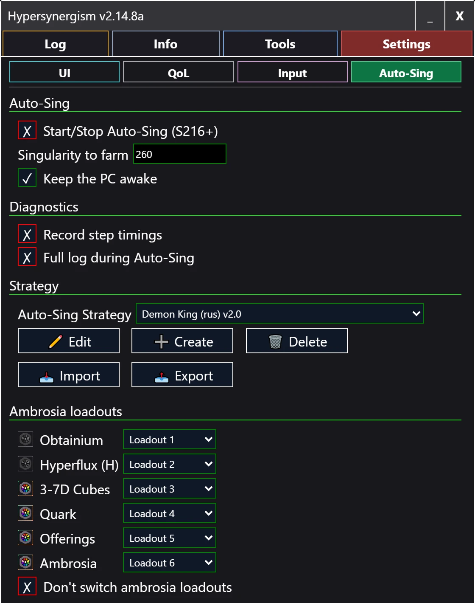
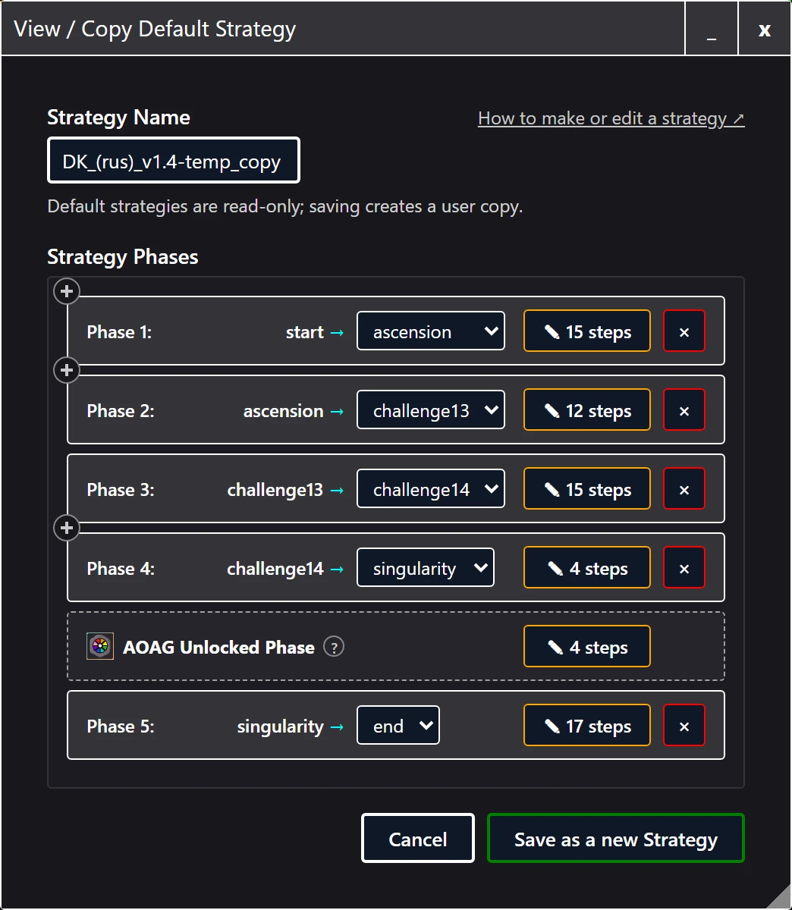
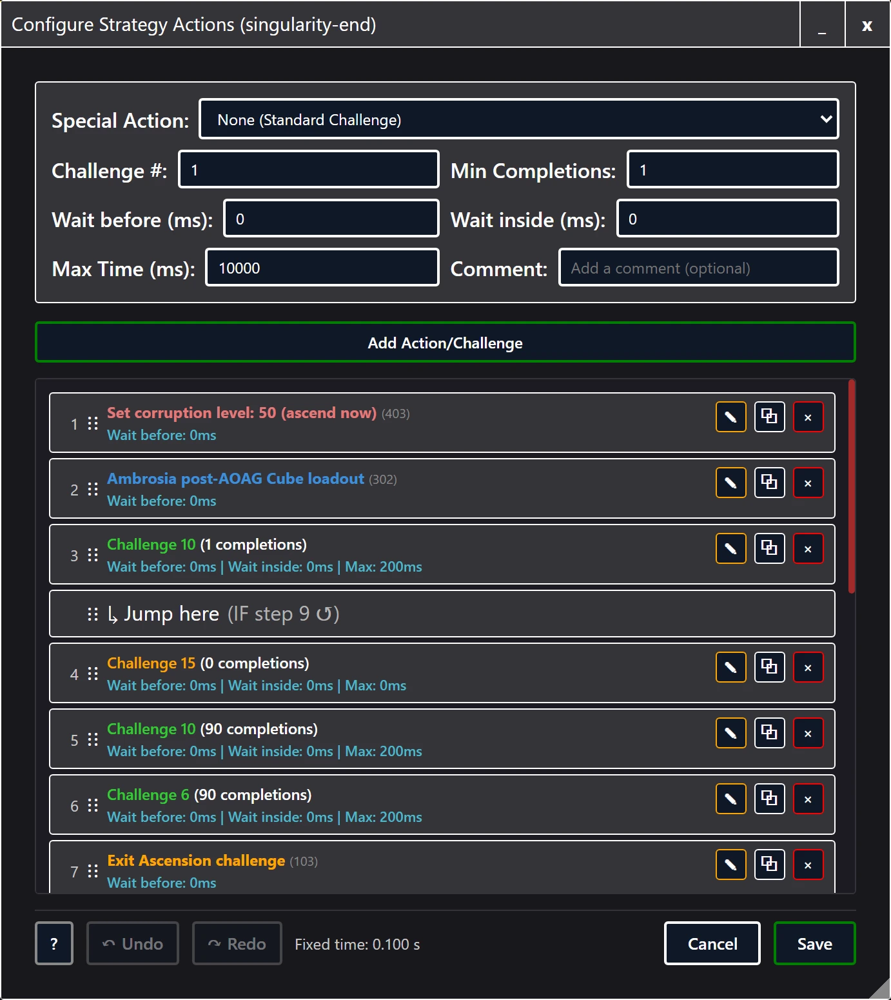
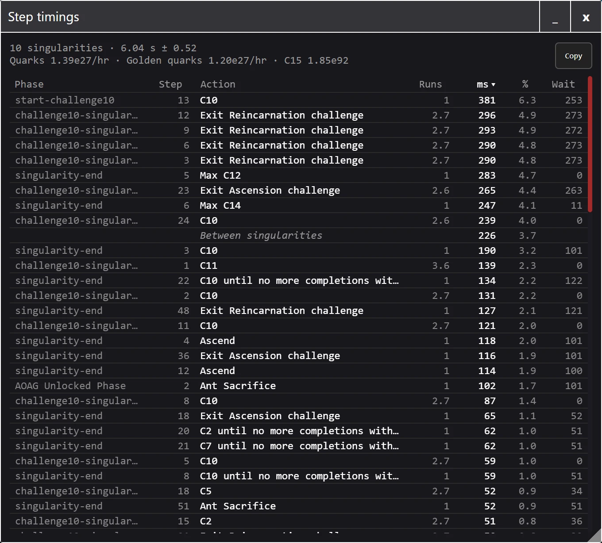

# Auto-Sing guide

Auto-Sing plays singularities for you, following a strategy. It's for the end game: S216+, and it only works fully once you've cleared EXALT6.

> [!IMPORTANT]
> It needs Tampermonkey or Steam: with the bookmark, it's slow and unreliable.

## Getting started

1. Open the mod panel (the mod's icon, top left), then Settings → **Auto-Sing**.
2. **Strategy:** pick one. The default strategies are a place to start; some of them are meant for the very end of the game. Those under **Previous Versions** are a strategy's earlier versions, kept in case the new one doesn't suit your account. Those under **Not Yet Retuned** (named "-temp") haven't been retuned by their authors since the game's corruption rework. To adapt one or make your own, see [Making or editing a strategy](#making-or-editing-a-strategy).
3. **Ambrosia loadouts:** for each role (pre-AOAG cubes, post-AOAG cubes, quarks, obtainium, offerings, luck), pick the game slot that holds that loadout. The [Ambrosia Heater](https://ferlieloi.github.io/synergism-hypersynergy/docs/wiki/heater-guide.html) (Tools tab) finds the best ones for your save. Each loadout switch resets the ambrosia bars' progress. If you don't want that, tick **⚙ Don't switch ambrosia loadouts**: Auto-Sing then never switches.
4. Turn on **⚙ Start/Stop Auto-Sing**, or click **Start Auto-Sing** in the [menu by the mod's icon](https://ferlieloi.github.io/synergism-hypersynergy/docs/wiki/interface.html#quick-menu).

The Auto-Sing window shows the time per singularity, the quarks and golden quarks gained per second, and how much of your quarks came from the Ants to Quark Corner. Its buttons: ⏸️ pause, 🔄 restart the singularity, 🟠 stop at the end of this singularity, 🔴 stop now, 📋 step timings (with **⚙ Record step timings** on), 📊 details.

## Which singularity to farm

- Start low: a singularity should take 15 to 20 seconds at most. That can be 30 singularities below your highest, and that's normal.
- Then go up one singularity at a time, as long as golden quarks per second keep going up.
- Wait for 10 to 15 singularities before you compare: one singularity alone varies too much.

## When a run stops or stalls

Auto-Sing keeps its speed when the game is in another tab. What can still stop or slow it:
- **The computer going to sleep.** The **⚙ Keep the PC awake** setting prevents it while the game is in view. On Steam, it also works while the window is minimized or covered and while the PC is locked. In a browser, it doesn't: for another tab, a minimized or covered window, or a locked PC, change your computer's sleep settings instead.
- **Chrome's Energy Saver** (a leaf icon next to the address bar). It can freeze a hidden tab after 5 minutes. Turn it off in `chrome://settings/performance`, or keep the game window in view.
- **A singularity much slower than the others, or one that never ends.** The strategy doesn't suit your account at that singularity: farm a few singularities lower ([Which singularity to farm](#which-singularity-to-farm)). To see where it waits, turn on **⚙ Full log during Auto-Sing** (Settings → Auto-Sing) and tick **Debug logs** under the mod panel's [Log tab](https://ferlieloi.github.io/synergism-hypersynergy/docs/wiki/tools.html#mod-log): each step writes a line, numbered as in the phase's actions window (✎). A step that ran out of time shows there even without the full log. **⚙ Record step timings** shows which steps take the time ([Testing a strategy](#testing-a-strategy)).
- **A game window left open.** During a run, Auto-Sing answers the game's confirmations and closes its messages, yours included. A window that asks you for something (an amount, a purchase) or an information message stays open, and Auto-Sing waits behind it at the end of the singularity: close it.
- **Your game settings after a run.** Auto-Sing changes some game settings for its run (auto-buy toggles, buy amounts, cube opening…) and puts them back when it stops, also after a failed start. If the game was reloaded or closed during a run, they're put back at the next load, with a notification. An Exalt the run was in is left as it is.

---

## Making or editing a strategy

### Start from a default strategy

Editing a default strategy is easier than starting from a blank one:
1. Select the default strategy closest to your account, then click **✏️ Edit**: it opens a copy that you save under a new name.
2. Change one thing at a time, then compare the two versions (see [Testing a strategy](#testing-a-strategy)).

The edits players make most often:
- **Corruption levels:** the default strategies set 20 before leaving the first C15, then 50 at the start of the last phase. Corruptions were reworked in the game's 4.4.0, so these levels are only a starting point: try your own.
- **The last C15 loop:** its IF step jumps back while C15 is below 1exxx. Lower the value if your account never reaches it, raise it if it gets there easily.
- **Waits:** shorten a step's Wait before or Wait inside when your account doesn't need it, lengthen it when the next step starts too early.
- **Max Time:** lower it on a challenge step that keeps running without getting its completions.

### How Auto-Sing follows a strategy

A strategy is a list of **phases**. Each phase covers a part of the singularity, from one game stage to another. To see your current stage: the game's Settings → Stats for Nerds → Miscellaneous.

- Phases follow each other: the first starts at "start", each one starts where the previous one ends, and the last one is "singularity → end".
- Auto-Sing reads the current stage, runs the steps of the phase that covers it from top to bottom, then reads the stage again. A phase runs again as long as the stage stays in its range.
- A phase doesn't reset by itself. Only Ascend, Exit Ascension challenge, entering an ascension challenge and "Set corruption level" (with Ascend immediately) do.
- **AOAG phase:** once the AOAG rune is unlocked (P4x5), Auto-Sing stops the current phase and runs the AOAG phase, then singularity → end. It starts with "Set corruption level" 0: no offering penalty to buy the AoAG rune.
- At the end of each loop, Auto-Sing switches to your Quark loadout, exports for quarks, levels Infinite Ascent, and opens one Platonic Cube before the next singularity. It also exports once when it starts, so the quarks saved up since your last export are collected at your current strength and kept out of the run's stats.

### The strategy window

In Settings → Auto-Sing:
- **➕ Create** opens a new strategy with two empty phases, "start → singularity" and "singularity → end", and the AOAG phase between them (starting from a default is usually easier).
- **✏️ Edit** opens the selected one. Default strategies can't be changed: Edit opens a copy that you save under a new name.
- **📤 Export** copies the strategy to share it; **📥 Import** adds one from a copy.

In the window:
- **Strategy Name** at the top.
- Each row is a phase: **Phase N: start → [end ▾] [✎ k steps] [×]**. Change a phase's end with its dropdown, open its steps with ✎, delete it with ×. The last two phases' ends are fixed, and the last phase can't be deleted.
- The dashed **AOAG Unlocked Phase** row sits right before the last phase, singularity → end, which is where it runs. Hover its **?** to see when it starts.
- The round **+** on a phase's left border adds a phase: it splits that phase in two.
- "0 steps" in red: a phase needs at least one step.
- **Create Strategy** / **Update Strategy** saves.

### The actions window (✎)

Steps run from top to bottom. Pick a **Special Action**, fill in the fields shown, then click **Add** (or press Enter). New steps go where **Add Here** is; drag it, or double-click a step, to add elsewhere.

**None** = a challenge step:
- **Challenge #**: the challenge (1–15).
- **Min Completions**: stay in it until it has this many. 0 = enter it, then wait.
- **Wait before (ms)**: wait before the step starts.
- **Wait inside (ms)**: once Min Completions is reached, wait this long before the next step.
- **Max Time (ms)**: go to the next step after this long, even if Min Completions isn't reached (Wait before not counted).

The other actions are grouped in the dropdown (Exit and Ascend, Game actions, Challenges, Ambrosia loadouts, Corruption level…). Each shows only the fields it uses. A few:
- **601-610 - C1-C10 until no more completions**: runs one of C1–C10 until it stops getting completions.
- **403 - Set corruption level**: sets the level used from the next ascension. With **Ascend immediately** ticked, it ascends right away (or leaves the current ascension challenge). Set the actual level: the game adds your free levels on top.
- **405 - Cleanse corruption**: the game's Cleanse, without ascending: lowers the current level to 0 at once, or to your highest cleared level with **Cleanse to highest cleared level** ticked. The next ascension uses that level too.
- **Store C15**: keeps C15's current score for an IF step to compare against.
- **159 - Set Auto Rune**: turns the game's Auto Rune ON or OFF. The game keeps it through a singularity: turn it back ON in your strategy. OFF also clears the rune you picked for it.
- **801 - Buy rune**: clicks the Sacrifice button of the chosen rune, which spends all your offerings on it. The AOAG rune has its own action, 901 - Click AOAG.
- **904 - Pause Autosing**: pauses autosing before the next step, to look at the game while testing a strategy. Resume with ▶️ in the Autosing panel.

#### If-jump steps

An If-jump step (an IF row ① in the list) jumps to its **Jump here** row ② when its condition holds, else the steps continue below it.
- **Challenges** mode: compares a challenge's completions (If Challenge) with Value, using > or <.
- **Stored C15 value** mode: compares C15's current score with the stored score × 10^Multiplier.
- **AOAG bought** mode: jumps when the AOAG rune is bought, or not bought, as chosen. Put it after a Click AOAG step to retry when the purchase failed: jump back to a step that waits or ascends first, and set Max jumps. Needs the mod's patched game (not the bookmarklet): elsewhere it never jumps, with a warning in the log.
- **Max jumps** ③: the IF jumps at most this many times per phase run, then continues below it even if its condition still holds (0 = no limit). It keeps an account that never reaches a C15 target from looping forever. The default strategies' last C15 loop has 5.
- An IF checks its condition at most once per game tick (5 ms). A loop with nothing that waits, such as an IF jumping to itself, checks once per tick: Max jumps 100 then lasts about half a second. Add a Wait before to check less often.
- The IF row says where it jumps (→ step N), and the Jump here row which IF it belongs to: click either one to see the other. ↺ means the IF jumps back (a loop).
- Follow the colored line from an IF to its **Jump here** row. Drag the arrow or the row’s handle to change the destination. Hold Shift while dragging an IF to pick up its jump marker. Release Shift to leave the marker where it is.

#### Editing steps

- ✎ on a step loads it into the fields: change them, then **Update step N**.
- ⧉ duplicates a step, × deletes it, ⋮⋮ drags it.
- Undo / Redo (Ctrl+Z / Ctrl+Y) are at the bottom, next to **Fixed time**: the time the phase spends waiting, IF jumps not followed.
- Comments are just for you.

> [!WARNING]
> **Save** in the actions window only keeps your changes in the strategy window. Click **Update Strategy** (or **Create Strategy**) there to save for good.

### Testing a strategy

Turn on **⚙ Record step timings** in Settings → Auto-Sing, then start Auto-Sing. 📋 in the Auto-Sing window shows where a singularity's time goes, step by step:
- **Runs**: times per singularity. **ms**: time per singularity. **%**: its part of a singularity. **Wait**: the part of ms spent in the step's Wait before.
- **Between singularities** and **Outside the steps** are the time spent in no step of your strategy.
- Click a column's title to sort by it. **Copy** gives the table as text, to compare two runs or share one.

To compare two versions of a strategy:
- Run each for 10 to 15 singularities: one singularity alone varies too much.
- Keep the same ambrosia loadouts: two heats at the same singularity can differ by 15%.
- Look at both quarks and golden quarks per hour, not only the time.

> [!TIP]
> The table is emptied at the next start: Copy it first.
