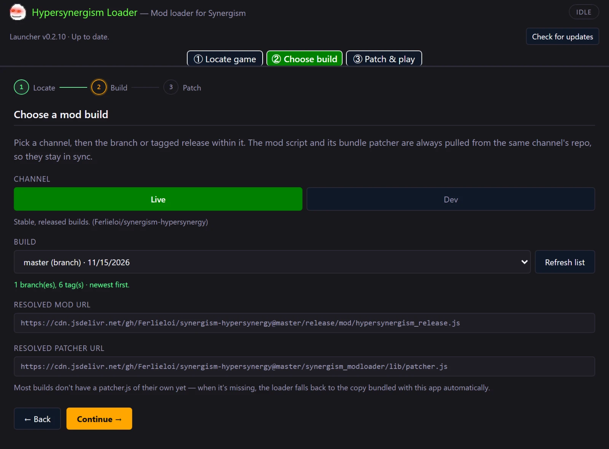

# Installation guide

Hypersynergism runs in a browser with Tampermonkey, or with the Steam game on Windows through its own loader. Either way, the mod is downloaded each time the game starts, always in its latest version.

## In a browser: Tampermonkey (recommended)

1. **Install Tampermonkey** for your browser: [Chrome](https://chromewebstore.google.com/detail/dhdgffkkebhmkfjojejmpbldmpobfkfo), [Firefox](https://addons.mozilla.org/firefox/addon/tampermonkey/), [Edge](https://microsoftedge.microsoft.com/addons/detail/iikmkjmpaadaobahmlepeloendndfphd) or [Opera](https://addons.opera.com/extensions/details/tampermonkey-beta/).
2. **Chrome-based browsers (Chrome, Edge, Brave, Opera…): allow user scripts.** Open the browser's Extensions page, find Tampermonkey, open **Details** (or **Manage extension**) and turn on **Allow User Scripts**. If that option isn't there, follow [Tampermonkey's instructions](https://www.tampermonkey.net/faq.php?q=Q209). Firefox doesn't need this.
3. **[Install the Hypersynergism loader](https://cdn.jsdelivr.net/gh/Ferlieloi/synergism-hypersynergy@master/src/loader/tampermonkey-bridge.user.js).** Tampermonkey opens an installation page: click **Install**.
4. **Open or reload [Synergism](https://synergism.cc/).** The mod now loads with the game every time.

If the install link shows code instead: copy all of it, click the Tampermonkey icon → **Create a new script**, replace the example code with what you copied, press **Ctrl+S** (**Cmd+S** on a Mac), then reload the game.

The mod also works on the game's copy at [pseudo-corp.github.io/SynergismOfficial](https://pseudo-corp.github.io/SynergismOfficial/), which has its own saves and no login, cloud saves or purchases.

## On Steam (Windows)

The Hypersynergism Loader is a small Windows app that patches a copy of the game and starts it with the mod. Your Steam game itself isn't changed: Steam's Play button still starts it without the mod.

1. **Download the loader** from the [releases page](https://github.com/Ferlieloi/synergism-hypersynergy/releases): the latest release named **Hypersynergism Loader**, file `HypersynergismLoader-Setup-….exe`. Run it; it needs no administrator rights. The installer isn't signed, so Windows may show "Windows protected your PC": click **More info**, then **Run anyway**.
2. **① Locate game:** **Auto-detect** finds your Steam folder (or **Browse…** to it), then **Continue →**.
3. **② Choose build:** keep the **Live** channel and its **master** build, the latest version, then **Continue →**.
4. **③ Patch & play:** click **Patch & launch**. The game starts with the mod.

The next times, open the loader and click **Launch last played build** on its first screen. When the game has been updated or a new mod version needs it, the loader asks you to patch again: the button becomes **Patch & launch last played**. Close the game before patching. The loader updates itself.

## Check that it works

- The mod's icon shows at the top left of the game. Click it to open the mod panel: its title reads "Hypersynergism v" and the mod's version.
- If part of the game's patch couldn't be applied, a notification says so once at load, with the details in the panel's **Log** tab.
- A rainbow border around the icon means a newer version is out: reload the page in a browser, restart the game from the loader on Steam.

## Live or Dev

The mod comes from one of two channels: **Live** (Ferlieloi's repository, the default, more stable) or **Dev** (maenhiir's, Shewchou's repository: new features first).

- **Steam:** pick the channel at step ②.
- **Tampermonkey:** open Tampermonkey's dashboard, edit **HyperSynergism Bridge Loader**, change the line `var repo = defaultRepo(false);` to `var repo = 'maenhiir';`, save with **Ctrl+S** and reload the game. Back to Live: `var repo = 'Ferlieloi';`. When Tampermonkey updates the script by itself, you're back on Live.

## With a bookmark (not recommended)

> [!WARNING]
> Loaded by a bookmark, the mod can't reach the game's internals: several features are missing, slower or less reliable, Auto-Sing among them. The mod then shows a window explaining how to switch to Tampermonkey.

1. Create a bookmark with any name. As its address, paste the whole content of [release/loader/loader.js](https://github.com/Ferlieloi/synergism-hypersynergy/blob/master/release/loader/loader.js) (it starts with `javascript:`).
2. Each time: load the game, close its offline popup, then click the bookmark.

## If it doesn't load

- **"The game started before the mod's loader":** the loader reloads the page by itself, up to three times; then refresh it yourself. On a Chrome-based browser, check step 2 (**Allow User Scripts**).
- **Still stuck:** ask in the [HyperSynergism thread](https://discord.com/channels/677271830838640680/1456904896099127367) on the game's Discord (the link opens once you've [joined the server](https://www.discord.gg/ameCknq)).
